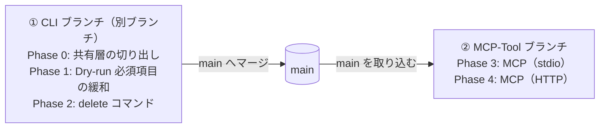
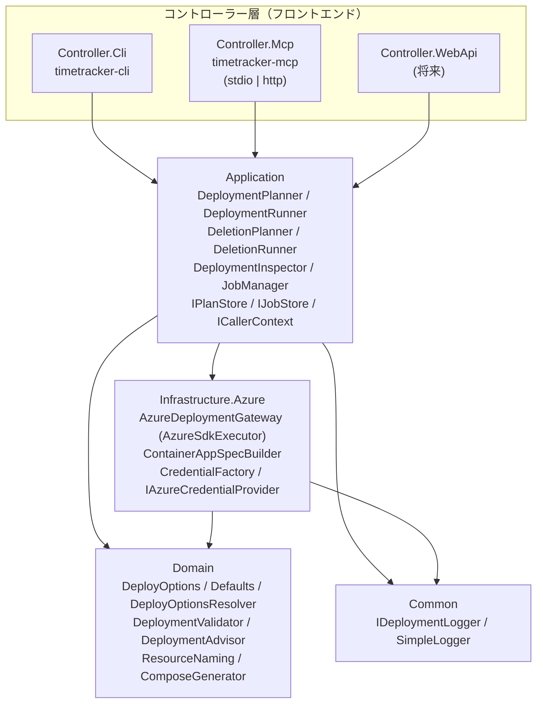

# MCP ツール設計案（Timetracker.Controller.Mcp）

- ステータス: 設計案 第 2 版（オーナー回答を反映。コード変更はまだ行っていない）
- 対象ブランチ: `MCP-Tool`
- 前提: `main`（a32cc3d, v0.6 系 / .NET 10）時点のコード

### 改訂履歴
| 版 | 内容 |
|---|---|
| 1 | 初版 |
| 2 | オーナー回答を反映。パスワードは引数と環境変数の両方を受け付け、環境変数を推奨する。デプロイは非同期ジョブにする。削除ツールを追加する（CLI に先に実装）。Dry-run では subscription / resource_group を不要にする（CLI に先に実装）。HTTP 公開と WebAPI フロントエンドを見据えた構成にする。動作確認クライアントの方針と配布形態の比較を追加 |

---

## 1. 目的とスコープ

### 1.1 目的
既存の CLI（`Timetracker.Controller.Cli`）と同じ機能を、**MCP（Model Context Protocol）サーバー**として公開する。Claude Code などの MCP クライアントから、対話しながら以下を行えるようにする。

- パラメータの確認・検証（既定値、命名規則、DB 種別とタグの組み合わせなど）
- Dry-run（`docker-compose.yml` / `.env` の生成）
- Azure Container Apps へのデプロイ（計画 → 確認 → 実行の 2 段階、非同期ジョブ）
- デプロイ済み環境の状態確認（URL、イメージタグ、スペック、稼働状態）
- デプロイ済み環境の削除（計画 → 確認 → 実行の 2 段階、非同期ジョブ）

README の「将来の GUI 化に備えドメイン層とコントローラー層を分離」という方針に沿い、**CLI と並ぶフロントエンドの一つ**として追加する。さらに将来の **WebAPI フロントエンド**も同じアプリケーション層の上に載せられる構成にする。

### 1.2 スコープ
| 項目 | 扱い |
|---|---|
| stdio トランスポート（ローカル実行） | 対象（最初に実装） |
| Streamable HTTP トランスポート（リモート公開） | **設計に含める**。実装は stdio の後（Phase 4） |
| WebAPI フロントエンド | 本設計の対象外。ただしアプリケーション層を共有できる構成にする（3.4） |
| 削除機能 | 対象。**CLI に先に実装**し、MCP は同じアプリケーション層を使う |
| 本番環境構築 | 対象外（ツールの目的「検証環境の構築支援」は変えない） |
| スケール設定・永続ボリューム等の新機能 | 対象外 |

### 1.3 ブランチと実施順
オーナー方針に従い、CLI 側の変更を別ブランチで MCP より先に行う。



- CLI ブランチは 1 本にまとめても、Phase ごとに分けてもよい（7 章 R-1）
- MCP-Tool ブランチは、現時点ではこの設計書だけを持つ。実装を始める前に main を取り込む

---

## 2. 現状コードの分析と MCP 化の課題

| # | 現状 | MCP 化での課題 |
|---|---|---|
| A | `AzureSdkExecutor` / `ContainerAppSpecBuilder` / `CredentialFactory` が **`Timetracker.Controller.Cli` プロジェクト内**にある | MCP プロジェクトから CLI（Exe）プロジェクトを参照するのは不適切。共有ライブラリへの切り出しが必要 |
| B | デプロイの手順（検証 → RG → Environment → DB/Redis/TT）が `Program.cs` のトップレベル文に直書き | MCP・WebAPI からも同じ手順を呼べるよう、アプリケーションサービスに切り出す必要がある |
| C | 既定値の解決（DB 種別に応じたタグ、アプリ名の小文字化、スペック既定値）も `Program.cs` にある | CLI と MCP で解決ロジックがずれる恐れ（No.28 と同種の問題）。共通化が必要 |
| D | `SimpleLogger` が `Console.Out`（stdout）に出力 | **stdio トランスポートでは stdout が JSON-RPC 専用**。stdout に 1 行でもログが出るとプロトコルが壊れる。ログ出力先の抽象化が必須 |
| E | `CreateOrUpdateContainerAppAsync` は戻り値なしで、エンドポイント URL はログに出すだけ | ツール結果として URL 等を構造化して返すには戻り値（結果オブジェクト）が必要 |
| F | 既存リソースの事前確認（RG/Environment のリージョン不一致、既存 DB アプリ）は「作成処理の途中」で行われる | 実行前に「何が起きるか」を提示して確認を取りたい。読み取り専用の事前確認（プラン）処理が必要 |
| G | `ComposeGenerator.Validate` は最初のエラーで例外を投げ、Dry-run でも subscription / resource-group を必須とする | 全エラーを列挙したい。Azure 用の検証と共通の検証を分ける必要がある（4.5） |
| H | Dry-run は `.env` をカレントディレクトリに書く | MCP サーバーのカレントディレクトリはクライアント依存で予測できない。HTTP ではサーバーとクライアントのファイルシステムが別になる |
| I | デプロイは Environment 作成を含めて数分〜10 分程度かかる | MCP クライアントのツール呼び出しタイムアウトを超える可能性がある → **非同期ジョブ（決定済み）** |
| J | DB/アプリのパスワードを引数で受け取る | MCP のツール引数・結果は LLM のコンテキストに入る → **引数と環境変数の両方、環境変数を推奨（決定済み）** |
| K | 認証はプロセス単位（`CredentialFactory`）。作成したリソースに目印（タグ）がない | HTTP ではリクエストごとに呼び出し元が変わる。削除時に「本ツールが作ったリソースか」を判別できない |

---

## 3. 全体アーキテクチャ

### 3.1 プロジェクト構成（案）

```
src/
  Timetracker.Common/                   (既存) ロガー抽象 + 実装
  Timetracker.Domain/                   (既存) DeployOptions, Defaults, 検証, Compose 生成, 命名, 警告
  Timetracker.Application/              (新規) ユースケース（計画・実行・状態・削除）、ジョブ管理、ストア抽象
  Timetracker.Infrastructure.Azure/     (新規) Azure SDK 呼び出し、仕様生成、資格情報
  Timetracker.Controller.Cli/           (既存) CLI フロントエンド（薄くなる）
  Timetracker.Controller.Mcp/           (新規) MCP フロントエンド（stdio / HTTP を起動引数で切り替え）
  Timetracker.Controller.WebApi/        (将来) WebAPI フロントエンド
tests/
  Timetracker.Domain.Tests/             (既存)
  Timetracker.Application.Tests/        (新規)
  Timetracker.Infrastructure.Azure.Tests/ (新規) 既存の Azure 系テストを移設
  Timetracker.Controller.Cli.Tests/     (既存) CLI 固有のテストのみ残す
  Timetracker.Controller.Mcp.Tests/     (新規)
```

命名は既存の `Timetracker.Controller.Cli` に合わせて `Timetracker.Controller.Mcp`（アセンブリ名 `timetracker-mcp`）とする。

### 3.2 依存関係



- **Application** はトランスポート（CLI / stdio / HTTP）を知らない。呼び出し元の情報（誰か、どの資格情報か）は `ICallerContext` で受け取る
- **Infrastructure.Azure** は `IAzureDeploymentGateway` を実装する。Application の単体テストではゲートウェイをモックし、`ArmClient` のモックは Infrastructure のテストに閉じる
- CLI は Application のサービスを同期的に（ジョブを使わず）呼ぶ。MCP / WebAPI はジョブ経由で呼ぶ

### 3.3 MCP サーバーの実行形態
- 言語・ランタイム: C# / .NET 10（既存と同じ。ドメイン層を直接再利用できるため）
- SDK: 公式 MCP C# SDK（NuGet `ModelContextProtocol`、HTTP 用に `ModelContextProtocol.AspNetCore`）。バージョンは実装時点の最新安定版を確認して固定する
- 起動引数でトランスポートを切り替える:
  - `timetracker-mcp`（既定）または `timetracker-mcp --transport stdio` … `WithStdioServerTransport()`
  - `timetracker-mcp --transport http --urls http://0.0.0.0:8080` … `WithHttpTransport()` + `MapMcp("/mcp")`
- ツールの実装（`Tools/` 配下）はトランスポートに依存させない。トランスポートごとの違い（資格情報、パスワードの取得元、ファイル出力の可否）は **`McpHostProfile`**（stdio 用 / HTTP 用）として DI で差し替える

| 項目 | stdio | HTTP |
|---|---|---|
| 想定 | 利用者の PC でクライアントが子プロセスとして起動 | Container Apps 等にホストし、複数人が接続 |
| 呼び出し元の認証 | 不要（OS ユーザー = 利用者） | **必須**。MCP の認可仕様（OAuth 2.1）に従い Microsoft Entra ID のトークンを検証 |
| Azure の資格情報 | 起動時設定の認証モード（`CredentialFactory`） | 4.11 参照（サーバーのマネージド ID、または利用者本人の権限） |
| パスワードの環境変数 | 使える（推奨） | **使わない**（サーバーの環境変数は全利用者で共有になるため）。引数のみ |
| Dry-run のファイル出力 | ローカルに書き込む | 書き込まない。内容を返す（4.5） |
| ログ | stderr + MCP ログ通知 + ジョブログ | 標準出力（コンテナログ）+ MCP ログ通知 + ジョブログ |
| 計画・ジョブの保持 | プロセス内メモリ | プロセス内メモリ（1 レプリカ固定）。複数レプリカにする場合は永続ストア（3.4） |

### 3.4 HTTP 公開と WebAPI を見据えた設計方針
1. **ユースケースは Application に置く**: MCP のツールも将来の WebAPI のエンドポイントも、`DeploymentPlanner.PlanAsync` などを呼ぶだけの薄い層にする。MCP ツールと REST API は 1 対 1 に対応させる

   | MCP ツール | WebAPI（将来・案） |
   |---|---|
   | `get_deployment_options` | `GET /api/options` |
   | `validate_deployment` | `POST /api/validations` |
   | `generate_compose` | `POST /api/compose` |
   | `list_subscriptions` | `GET /api/subscriptions` |
   | `plan_deployment` | `POST /api/deployment-plans` |
   | `start_deployment` | `POST /api/deployment-plans/{planId}/execute` → `202 Accepted` + `Location: /api/jobs/{jobId}` |
   | `get_job_status` | `GET /api/jobs/{jobId}` |
   | `get_deployment_info` | `GET /api/deployments/{subscription}/{resourceGroup}/{appName}` |
   | `plan_deletion` | `POST /api/deletion-plans` |
   | `start_deletion` | `POST /api/deletion-plans/{planId}/execute` |

2. **状態はストア抽象の向こうに置く**: 計画は `IPlanStore`、ジョブは `IJobStore` に保存する。初期実装はどちらもメモリ内。HTTP を複数レプリカにする、または再起動後もジョブ履歴を残す場合は Azure Table Storage や Redis の実装に差し替える
3. **呼び出し元を記録する**: 計画・ジョブに作成者（stdio では固定値、HTTP ではトークンの `oid`）を記録し、別の利用者の計画を実行したりジョブを参照したりできないようにする
4. **MCP のセッションに状態を持たせない**: 計画 ID・ジョブ ID だけで処理を続けられるようにし、Streamable HTTP のステートレスモードでも動くようにする
5. **同じホストへの同居も可能にする**: WebAPI を作るときは、同じ ASP.NET Core ホストで `/mcp` と `/api` を両方公開することも、別ホストにすることもできる（Application を共有しているため）

---

## 4. ツール設計

### 4.0 サーバー共通設定（起動時の環境変数／引数）

ツールの引数ではなく、MCP クライアント設定（`mcp.json` 等）またはホストの設定で渡す。

| 設定 | 環境変数 | 既定 | stdio | HTTP | 説明 |
|---|---|---|---|---|---|
| トランスポート | `--transport` 引数 | `stdio` | – | – | `stdio` / `http` |
| 認証モード | `TT_MCP_AUTH_MODE` | `default` | ✔ | ✔（4.11） | `default` / `azure-cli` / `sp-env` / `device-code` / `managed-identity`（`CredentialFactory` をそのまま使用）。HTTP では加えて `on-behalf-of` |
| 既定サブスクリプション | `TT_MCP_DEFAULT_SUBSCRIPTION` | なし | ✔ | ✔ | ツール引数を省略したときに使う |
| 既定リソースグループ | `TT_MCP_DEFAULT_RESOURCE_GROUP` | なし | ✔ | ✔ | 同上 |
| DB パスワード | `TT_MCP_DB_PASSWORD` | なし | ✔ | **無視** | 4.10 |
| アプリパスワード | `TT_MCP_TRACKER_PASSWORD` | なし | ✔ | **無視** | 4.10 |
| Dry-run 出力ルート | `TT_MCP_OUTPUT_ROOT` | なし | ✔ | – | 設定すると `generate_compose` の出力先をこの配下に制限する |
| 詳細ログ | `TT_MCP_VERBOSE` | `false` | ✔ | ✔ | VERBOSE ログを出す。スタックトレースはサーバー側ログにのみ出す |
| Entra ID 設定 | `TT_MCP_AUTH__TENANT_ID` 等 | なし | – | ✔（必須） | HTTP の呼び出し元認証（テナント、Audience、必要なアプリロール） |

認証モードをツールの引数にしない理由: LLM が会話の途中で認証方式を切り替えると、意図しない資格情報でデプロイされ得るため（No.6 と同じ考え方）。

### 4.1 ツール一覧

| ツール名 | 概要 | Azure アクセス | annotations（readOnly / destructive / idempotent / openWorld） |
|---|---|---|---|
| `get_deployment_options` | 既定値・選べる値・命名規則・制約を返す | なし | ✔ / – / ✔ / – |
| `validate_deployment` | パラメータを検証し、解決済みの設定を確認する | なし | ✔ / – / ✔ / – |
| `generate_compose` | Dry-run（compose / .env を出力） | なし | – / – / ✔ / – |
| `list_subscriptions` | 利用できるサブスクリプションの一覧 | 読み取り | ✔ / – / ✔ / ✔ |
| `plan_deployment` | 既存リソースを確認し、デプロイの実行計画を作る | 読み取り | ✔ / – / ✔ / ✔ |
| `start_deployment` | 計画に基づいてデプロイを開始する（非同期ジョブ） | 書き込み | – / ✔ / – / ✔ |
| `get_job_status` | デプロイ・削除ジョブの進捗・ログ・結果 | なし（ジョブ参照） | ✔ / – / ✔ / – |
| `list_jobs` | 自分のジョブの一覧（実行中を含む） | なし | ✔ / – / ✔ / – |
| `get_deployment_info` | デプロイ済み環境の状態と URL | 読み取り | ✔ / – / ✔ / ✔ |
| `plan_deletion` | 削除対象を確認し、削除計画を作る | 読み取り | ✔ / – / ✔ / ✔ |
| `start_deletion` | 削除計画に基づいて削除を開始する（非同期ジョブ） | 書き込み | – / ✔ / ✔ / ✔ |

- 引数名は CLI オプションと 1 対 1 に対応する snake_case にする（`--tt-cpu` → `tt_cpu`）
- 各ツールに `outputSchema` を定義し、`structuredContent`（JSON）と人が読めるテキスト要約の両方を返す。`structuredContent` を使えないクライアントでもテキストだけで会話が続けられるようにする（5.7）
- 第 1 版の `get_deployment_status` は、削除ジョブも扱うため `get_job_status` に改名した

### 4.2 共通パラメータ（デプロイ設定）

`validate_deployment` / `generate_compose` / `plan_deployment` で共通。

| 引数 | 型 | 必須 | 既定 | CLI 対応 |
|---|---|---|---|---|
| `subscription` | string | Azure 操作では必須、Dry-run では不要 | `TT_MCP_DEFAULT_SUBSCRIPTION` | `--subscription` |
| `resource_group` | string | 同上 | `TT_MCP_DEFAULT_RESOURCE_GROUP` | `--resource-group` |
| `location` | string | – | `japaneast` | `--location` |
| `app_name` | string | – | `timetracker` | `--app-name` |
| `db_type` | enum `postgresql` \| `sqlserver` | – | `postgresql` | `--db-type` |
| `db_name` | string | – | `timetracker` | `--db-name` |
| `tt_tag` | string | – | DB 種別に応じた既定タグ | `--tt-tag` |
| `db_password` | string | △（4.10） | `TT_MCP_DB_PASSWORD`（stdio のみ） | `--db-password` |
| `tracker_password` | string | △（4.10） | `TT_MCP_TRACKER_PASSWORD`（stdio のみ） | `--tracker-password` |
| `tt_cpu` / `tt_memory_gi` | number | – | 1.5 / 3.0 | `--tt-cpu` / `--tt-memory` |
| `db_cpu` / `db_memory_gi` | number | – | 1.0 / 2.0 | `--db-cpu` / `--db-memory` |
| `redis_cpu` / `redis_memory_gi` | number | – | 0.5 / 1.0 | `--redis-cpu` / `--redis-memory` |

既定値の解決は新設する `DeployOptionsResolver`（Domain）で行い、CLI と MCP が同じ結果になるようにする。`validate_deployment` には `target`（`azure` | `compose`、既定 `azure`）を追加し、どちらの必須項目で検証するかを選べるようにする。

### 4.3 `get_deployment_options`
- 入力: なし
- 出力（例）:
  ```json
  {
    "db_types": ["postgresql", "sqlserver"],
    "default_tt_tags": { "postgresql": "11.0.1-linux-postgres", "sqlserver": "11.0.1-linux-mssql" },
    "defaults": { "location": "japaneast", "app_name": "timetracker", "db_name": "timetracker",
                  "tt_cpu": 1.5, "tt_memory_gi": 3.0, "db_cpu": 1.0, "db_memory_gi": 2.0,
                  "redis_cpu": 0.5, "redis_memory_gi": 1.0 },
    "app_name_rule": { "min_length": 2, "max_length": 26, "pattern": "^[a-z]([a-z0-9-]*[a-z0-9])?$", "no_double_hyphen": true },
    "resource_suffixes": ["-env", "-db", "-redis", "-tt"],
    "server": { "transport": "stdio", "auth_mode": "azure-cli",
                "password_env": { "db_password": true, "tracker_password": false } },
    "constraints": [
      "検証環境向け。Azure 上の DB データは永続化されない（DB コンテナ再起動で消える）",
      "SQL Server は Developer エディション（本番利用不可）",
      "Azure 上の SQL Server 構成ではサンプル DB を作成できない（空の DB を選択）",
      "Timetracker のメモリが 2Gi 以下だとサンプル DB 作成が OutOfMemory で失敗する"
    ],
    "tag_list_url": "https://hub.docker.com/r/densocreate/timetracker/tags"
  }
  ```
- 値はすべて `Defaults` / `AppNameValidator` / `ContainerImages` から生成し、二重管理しない
- `password_env` は「環境変数が設定済みかどうか」だけを返す（値は返さない）。LLM はこれを見て、パスワードを尋ねる必要があるかを判断できる

### 4.4 `validate_deployment`
- 入力: 4.2 の共通パラメータ + `target`
- 処理: `DeployOptionsResolver` で既定値を解決 → `DeploymentValidator`（Domain）で全エラーを列挙 → `DeploymentAdvisor`（Domain）で警告を生成
- 出力:
  ```json
  {
    "valid": false,
    "errors": ["不適切な組み合わせ: db-type='sqlserver' と tt-tag='11.0.1-linux-postgres' は対応していません。..."],
    "warnings": ["db_type=sqlserver のため、Azure 上ではサンプル DB を作成できません。"],
    "resolved": { "app_name": "timetracker", "db_type": "sqlserver", "tt_tag": "11.0.1-linux-postgres", "...": "...",
                  "db_password": "********（環境変数）", "tracker_password": "********（引数）" },
    "resource_names": { "environment": "timetracker-env", "tt": "timetracker-tt", "db": "timetracker-db", "redis": "timetracker-redis" }
  }
  ```
- 検証エラーは MCP のプロトコルエラーではなく、**ツール結果**（`valid: false`）として返す。LLM が自分で修正できるようにするため
- 警告（エラーではないが注意すべき点）: SQL Server でのサンプル DB の制約、`tt_memory_gi <= 2` のメモリ不足、既定以外のタグ（7.x 系など）の利用

### 4.5 `generate_compose`（Dry-run）
- 入力: 共通パラメータ（**subscription / resource_group は不要**）+ 以下

  | 引数 | stdio | HTTP |
  |---|---|---|
  | `output_dir`（絶対パス） | 必須 | 指定不可 |
  | `overwrite`（bool, 既定 false） | ✔ | – |

- 処理: 検証（`target=compose`）→ `ComposeGenerator.GenerateCompose` / `GenerateEnv`
- stdio:
  - `output_dir` に `docker-compose.yml` と `.env` を書き込む
  - 返すのはファイルのパス、`docker-compose.yml` の内容（秘密情報を含まない）、次の手順（`docker compose up -d`、`http://localhost:8080`）
  - `.env` は**内容を返さない**（パスワードを含むため）。パスだけ返す
  - 既存ファイルがあり `overwrite=false` の場合はエラーにする（以前の `.env` を上書きで失わないため）
  - `TT_MCP_OUTPUT_ROOT` を設定した場合は、その配下以外への書き込みを拒否する
- HTTP:
  - サーバーのファイルシステムには書かない。`docker-compose.yml` の内容と、パスワード部分をプレースホルダー（`DB_PASSWORD="<DB パスワードを設定>"`）にした `.env` の内容を返す
  - パスワードが引数で渡されていても `.env` には埋め込まない（応答として会話に再度出さないため）

**CLI 側で先に行う変更**（オーナー方針）: `ComposeGenerator.Validate` を「共通の検証」と「Azure 用の検証（subscription / resource-group 必須）」に分ける。CLI の `--dry-run` では Azure 用の検証を行わず、`Program.cs` の必須パラメータの確認もそれに合わせる。

### 4.6 `list_subscriptions`
- 入力: なし
- 出力: `[{ "subscription_id", "display_name", "state", "tenant_id" }]`
- 目的: ユーザーが ID を覚えていなくても、「どのサブスクリプションに作りますか？」と会話の中で選べるようにする

### 4.7 `plan_deployment` / `start_deployment`（2 段階実行・非同期ジョブ）

DB を再デプロイするとデータが消えるため、**計画（読み取りのみ）→ ユーザーの確認 → 実行**の 2 段階にする。

#### `plan_deployment`
- 入力: 4.2 の共通パラメータ
- 処理（すべて読み取り。`DeploymentPlanner`）:
  1. 検証（`validate_deployment` と同じ）
  2. リソースグループ: 存在の有無とリージョン（不一致なら警告。現行の `EnsureResourceGroupAsync` と同じ判定）
  3. Environment: 存在の有無とリージョン（不一致なら **ブロッカー**。現行の `EnsureContainerAppEnvAsync` と同じ判定）
  4. `-db` / `-redis` / `-tt` の各 Container App: 作成か更新か
  5. `-db` が既にある場合はデータ消失の警告（`WarnIfDbAppExistsAsync` と同じ内容）
- 出力:
  ```json
  {
    "plan_id": "pln_7f3c...",
    "expires_at": "2026-10-15T10:15:00Z",
    "blockers": [],
    "actions": [
      { "resource": "resource_group", "name": "rg-tt-verify", "action": "use_existing" },
      { "resource": "environment", "name": "timetracker-env", "action": "create" },
      { "resource": "container_app", "name": "timetracker-db", "action": "update", "data_loss": true },
      { "resource": "container_app", "name": "timetracker-redis", "action": "update" },
      { "resource": "container_app", "name": "timetracker-tt", "action": "update" }
    ],
    "warnings": ["DB アプリ 'timetracker-db' は既に存在します。更新すると DB のデータは失われます。"],
    "requires_data_loss_ack": true,
    "estimated_duration": "5〜10 分（Environment を新規作成する場合）"
  }
  ```
- 計画は `IPlanStore` に保存する（解決済みの `DeployOptions` を含む。パスワードはメモリ内だけに置き、永続ストアに切り替える場合は保存しない設計にする）。有効期限は 15 分

#### `start_deployment`
- 入力: `plan_id`（必須）、`acknowledge_data_loss`（bool。計画が `requires_data_loss_ack=true` の場合は `true` が必須）
- **デプロイのパラメータは受け取らない**。実行内容は `plan_id` に紐づく設定だけで決まるので、計画と違う内容で実行されることがない
- 処理:
  1. 計画の有効期限、ブロッカー、作成者（呼び出し元と同じか）を確認する
  2. 実行の直前にもう一度読み取り、計画時から状態が変わっていれば中止して再計画を促す（例: 計画時になかった DB アプリが作られていた）
  3. 同じ `subscription/resource_group/app_name` のジョブ（デプロイ・削除とも）が実行中なら拒否する（二重実行の防止）
  4. `JobManager` がバックグラウンドで `DeploymentRunner.RunAsync` を開始し、すぐに `job_id` を返す
- 出力: `{ "job_id": "job_...", "kind": "deploy", "status": "running", "poll_hint": "get_job_status を 15〜30 秒間隔で呼んでください" }`
- 計画は一度実行したら無効にする（同じ計画で 2 回実行できない）
- クライアントが進捗トークン（`progressToken`）を送ってきた場合は、ステップごとに `notifications/progress` も送る（ポーリングだけでも完結するようにし、通知は補助扱い）

> 将来: MCP 仕様の Tasks（長時間処理の標準化。2025-11-25 版では実験的な機能）が C# SDK と主要クライアントで安定したら、`start_*` + `get_job_status` から移行するか検討する。ジョブ管理は Application に閉じているので、MCP 側の変更だけで済む。

### 4.8 `get_job_status` / `list_jobs`
- `get_job_status` の入力: `job_id`、`log_offset`（int, 任意。差分取得用）
- 出力:
  ```json
  {
    "job_id": "job_...",
    "kind": "deploy",               // deploy | delete
    "status": "running",            // queued | running | succeeded | failed
    "target": { "subscription": "...", "resource_group": "rg-tt-verify", "app_name": "timetracker" },
    "current_step": { "index": 4, "total": 6, "name": "DB アプリを作成/更新中 (timetracker-db)" },
    "logs": [ { "level": "info", "message": "Container Apps Environment を作成: timetracker-env", "at": "..." } ],
    "next_log_offset": 12,
    "result": null,                 // 成功時（deploy）: { "endpoint": "https://timetracker-tt.xxx.japaneast.azurecontainerapps.io", "apps": [...] }
    "error": null,                  // 失敗時: メッセージと、どのステップまで終わったか
    "device_code_message": null     // device-code 認証時、ユーザーに表示すべきメッセージ
  }
  ```
- デプロイのステップ: ① 検証 ② リソースグループ ③ Environment ④ DB ⑤ Redis ⑥ Timetracker
- `list_jobs` の入力は `status`（任意）。呼び出し元が作ったジョブだけを返す
- ジョブは `IJobStore` に保存する（初期実装はメモリ内）。stdio ではプロセスが終了すると失われるが、Azure 側の状態は `get_deployment_info` で確認できる
- 実行中のジョブはキャンセルできない仕様にする。Azure の操作を途中で止めると中途半端な状態が残るため。必要になったら、ステップの区切りで止める方式を検討する

### 4.9 `get_deployment_info`
- 入力: `subscription`、`resource_group`、`app_name`
- 出力: 各リソースの有無、`provisioningState`、稼働状態、イメージ（タグ）、CPU/メモリ、最新リビジョン、管理タグ（4.12）、Timetracker の FQDN（`https://...`）
- 用途: 「さっきデプロイした環境の URL は？」「今のタグは？」への回答、ジョブが失われた後の状態確認、削除前の確認

### 4.10 秘密情報（パスワード）の扱い【決定: 引数と環境変数の両方を受け付け、環境変数を推奨】

ツールの引数と結果は LLM のコンテキスト（＝会話ログ）に残る。そのため以下の優先順位で値を決める。

| 優先 | 取得元 | stdio | HTTP |
|---|---|---|---|
| 1 | ツール引数 `db_password` / `tracker_password` | ✔（会話に残る旨を instructions で伝える） | ✔（唯一の手段。HTTPS 必須） |
| 2 | サーバー起動時の環境変数 `TT_MCP_DB_PASSWORD` / `TT_MCP_TRACKER_PASSWORD` | ✔（**推奨**。会話に値が出ない） | 使わない |
| – | どちらもない | 検証エラーにし、環境変数での設定方法を案内する | 検証エラー |

- 引数と環境変数の両方がある場合は引数を優先し、`resolved` にどちらを使ったかを示す（値は示さない）
- 共通のルール:
  - ツールの結果・ログ・エラーメッセージ・ジョブログにパスワードを含めない（`resolved` では `********` にマスクする）
  - stdio の Dry-run では `.env` の内容を返さない。HTTP ではプレースホルダーにする（4.5）
- 将来の検討: HTTP で引数を使わずに済むよう、Azure Key Vault のシークレット参照（`db_password_secret_uri`）を受け付ける

### 4.11 HTTP 公開時の Azure 資格情報

stdio では利用者の PC の資格情報（`az login` 等）をそのまま使う。HTTP では、だれの権限で Azure を操作するかを決める必要がある。`IAzureCredentialProvider.GetCredential(ICallerContext)` で抽象化し、どちらの方式にも対応できるようにしておく。

| 方式 | 内容 | メリット | デメリット |
|---|---|---|---|
| H1: サーバーの ID（`managed-identity` / `sp-env`） | MCP サーバーのマネージド ID の権限で操作する。だれが使えるかは Entra ID のアプリロールで制御する | 構成が簡単。利用者が Azure の権限を持っていなくてよい | 全員が同じ権限になる。Azure の操作ログ上は全員サーバーの ID に見える（だれの操作かはサーバーのログで追う） |
| H2: 利用者本人の権限（`on-behalf-of`） | 利用者のトークンを OBO フローで ARM 用のトークンに交換して操作する | 利用者自身の RBAC がそのまま効く。Azure の操作ログに本人が残る | Entra ID アプリ登録・同意の設定が必要。クライアントが MCP の OAuth に対応している必要がある |

- 推奨: 社内の限られたメンバーで使うなら H1 から始め、利用者ごとに権限を分けたくなったら H2 を追加する。どちらにするかは Phase 4 の着手時に決める（7 章 R-3）
- HTTP では、計画・ジョブの作成者をトークンの `oid` で記録し、本人のものだけ実行・参照できるようにする（3.4）

### 4.12 `plan_deletion` / `start_deletion`【決定: 削除ツールを作る。CLI に先に実装する】

#### 削除の範囲
- 対象は本ツールの命名規則に一致するリソースだけ: `{app}-tt` → `{app}-redis` → `{app}-db` → `{app}-env`（この順で削除する。Environment は中に Container App が残っていると削除できないため）
- **リソースグループは削除しない**（ユーザーが作った他のリソースを巻き込まないため）。リソースグループの削除はポータルや `az group delete` で行うよう案内する
- Container Apps Environment が自動で作った関連リソース（あれば）は Azure 側の挙動に任せる

#### 本ツールが作ったリソースかの判別（CLI ブランチで先に入れる）
現状、作成するリソースに目印がない。名前だけで判断すると、同じ名前の別のリソースを消すおそれがある。そこで:
- デプロイ時に、Environment と各 Container App にタグ `managed-by=timetracker-deployment-tool`、`tt-app-name={app}` を付ける（`ContainerAppSpecBuilder` で設定）
- 削除は、名前が一致し、**かつタグが付いているもの**だけを対象にする
- タグがない（この変更より前に作った）リソースは、計画の中で「タグなし」と示し、`include_untagged=true` を明示した場合だけ対象にする

#### `plan_deletion`
- 入力: `subscription`、`resource_group`、`app_name`、`include_untagged`（bool, 既定 false）
- 出力:
  ```json
  {
    "plan_id": "pln_d41a...",
    "expires_at": "2026-10-15T10:15:00Z",
    "targets": [
      { "name": "timetracker-tt", "type": "container_app", "exists": true, "tagged": true, "will_delete": true },
      { "name": "timetracker-redis", "type": "container_app", "exists": true, "tagged": true, "will_delete": true },
      { "name": "timetracker-db", "type": "container_app", "exists": true, "tagged": false, "will_delete": false,
        "reason": "管理タグがありません（include_untagged=true で対象にできます）" },
      { "name": "timetracker-env", "type": "environment", "exists": true, "tagged": true, "will_delete": false,
        "reason": "Environment 内に削除しない Container App が残るため削除できません" }
    ],
    "kept": ["resource_group: rg-tt-verify（削除しません）"],
    "warnings": ["DB のデータはすべて失われます。"],
    "confirmation_required": "start_deletion の confirm_app_name に 'timetracker' を指定してください"
  }
  ```
- Environment の中に、本ツールの命名規則以外の Container App があれば、Environment は削除しない

#### `start_deletion`
- 入力: `plan_id`（必須）、`confirm_app_name`（必須。計画の `app_name` と完全に一致すること）
- 処理は `start_deployment` と同じ: 作成者・有効期限の確認 → 直前の再確認（計画時から対象が変わっていれば中止）→ 二重実行の防止 → ジョブとして開始
- 削除のステップ: ① 再確認 ② `-tt` ③ `-redis` ④ `-db` ⑤ `-env`（対象のものだけ）
- 既に存在しないリソースは成功扱いにする（何度実行しても同じ結果になる）

#### CLI 側（先行実装）のコマンド案
```powershell
# 削除対象を表示するだけ（変更しない）
timetracker-cli delete --subscription <ID> --resource-group <RG> --app-name timetracker --dry-run

# 削除する（確認のためアプリ名の入力を求める。--yes で省略）
timetracker-cli delete --subscription <ID> --resource-group <RG> --app-name timetracker [--include-untagged] [--yes]
```
- 現在の `CliArgs` は書式 `[deploy] --option ...` なので、サブコマンド `delete` を追加し、サブコマンドごとに使えるオプションを分ける
- CLI の `delete` と MCP の `plan_deletion` / `start_deletion` は、同じ `DeletionPlanner` / `DeletionRunner`（Application）を使う

---

## 5. MCP サーバーのその他の要素

### 5.1 サーバー instructions
初期化時の `instructions` に、ツールを使う前提知識を書いておく（LLM が毎回 README を読まなくてよいように）。

- 本ツールは検証環境向け。Azure 上の DB は再デプロイや削除で消えること
- デプロイ・削除は必ず「`plan_*` → 結果をユーザーに示して確認 → `start_*`」の順に行うこと。`acknowledge_data_loss` と `confirm_app_name` は、ユーザーの明示的な同意を得てから指定すること
- `start_*` の後は `get_job_status` を間隔をあけて呼ぶこと
- パスワードは環境変数での設定を推奨すること。`get_deployment_options` の `password_env` が true ならパスワードを尋ねないこと
- SQL Server + Azure ではサンプル DB を作れないこと、Timetracker のメモリは 3Gi 以上を推奨すること

### 5.2 Resources（任意・Phase 3 の後半）
- `timetracker://docs/constraints`: 「本ツールの目的と注意事項」
- `timetracker://docs/rbac`: 必要な RBAC ロールとリソースプロバイダーの登録手順
- `timetracker://deployments/{subscription}/{rg}/{app}`: `get_deployment_info` と同じ内容

### 5.3 Prompts（任意・Phase 3 の後半）
- `deploy-timetracker`: サブスクリプションの選択 → DB 種別 → 検証 → 計画 → 実行までを案内する定型プロンプト
- `local-dry-run`: ローカルの Docker で動作を確認する手順

### 5.4 ログ
- stdio では stdout に一切書かない（JSON-RPC 専用のため）。Generic Host の既定コンソールロガーも stderr に出す設定にする（`LogToStandardErrorThreshold = Trace`）
- 出力先: (1) サーバー側ログ（stdio は stderr、HTTP は標準出力 = コンテナログ）、(2) MCP の `notifications/message`（クライアントが `logging/setLevel` した場合）、(3) ジョブログ（`get_job_status` で取得）
- `IDeploymentLogger` を実装した `JobLogger` が、上の 3 つに振り分ける

### 5.5 エラー処理
| 種別 | 返し方 |
|---|---|
| 入力検証エラー | ツール結果（`valid: false` または `isError: true`）+ 日本語メッセージ（既存のメッセージをそのまま使う） |
| Azure 認証エラー（`AuthenticationFailedException` 等） | ツール結果 `isError: true` + 認証モードごとの対処（`az login` 等） |
| Azure API エラー（`RequestFailedException`） | ステータス・エラーコード・メッセージを返す（例: `ManagedEnvironmentInvalidRequest`） |
| 未知・期限切れ・他人の plan_id / job_id | ツール結果 `isError: true`（他人のものは「存在しない」と同じ扱いにする） |
| 想定外の例外 | ツール結果 `isError: true`。スタックトレースは `TT_MCP_VERBOSE=true` のときにサーバー側ログにだけ出す |

### 5.6 同時実行
- 同じ `subscription/resource_group/app_name` に対するジョブ（デプロイ・削除）は同時に 1 つまで
- stdio でサーバーを複数起動した場合（クライアントを 2 つ開いた場合など）は、プロセス間では排他できない。直前の再確認（4.7・4.12）で、ある程度は防げる

### 5.7 特定のクライアントの機能に頼らない
クライアントごとに対応している MCP の機能に差があるため（6.1）、**どの機能もなくても会話が完結する**ようにする。

| MCP の機能 | 使い方 | 対応していないクライアントでの動き |
|---|---|---|
| `structuredContent` / `outputSchema` | 結果を JSON で返す | テキストの要約だけで続けられるよう、要約に必要な情報（plan_id、job_id、URL、警告）を必ず含める |
| 進捗通知 | ステップごとに通知 | `get_job_status` のポーリングで同じ情報を得られる |
| ログ通知 | 実行ログ | `get_job_status` の `logs` で得られる |
| tool annotations | 確認ダイアログの出し分け | 2 段階の確認（計画 → 同意フラグ）をサーバー側で強制しているので、安全性は変わらない |
| Elicitation（ユーザーへの入力要求） | 使わない | – |

---

## 6. オーナーからの質問への回答

### 6.1 動作確認のクライアントを決める必要性（Q5）

**結論: 開発中は Claude Code（+ MCP Inspector）で進めてよい。特定のツールに絞る必要はないが、「利用者が使うクライアント」での確認はリリース前に 1 回は必要。**

決める必要があるのは、MCP の仕様は共通でも、クライアントごとに次の点が違い、1 つのクライアントでしか確認していないと、ほかのクライアントで初めて問題が見つかるためです。

| 違いが出る点 | 例 | 本ツールへの影響 |
|---|---|---|
| ツール呼び出しのタイムアウト | クライアントによって数十秒〜数分。設定できるものとできないものがある | 非同期ジョブにしたので、`start_*` がすぐ返れば影響はない。`plan_*`（Azure の読み取り数回）がタイムアウトしないかは確認が必要 |
| 対応している MCP の機能 | 進捗通知、ログ通知、`structuredContent`、Resources、Prompts、OAuth（HTTP）への対応状況が違う | 5.7 のとおり、なくても動く設計にする。HTTP 公開では **OAuth に対応したクライアントか**が重要 |
| ツール実行の承認 UI | 毎回確認するもの、許可リストで省略できるもの | `start_deletion` などを自動承認にしないよう、利用者向けの設定例で案内する |
| サーバー設定の書き方 | Claude Code は `claude mcp add` / `.mcp.json`、VS Code は `.vscode/mcp.json`（パスワードを入力させる `inputs` がある）、Claude Desktop は `claude_desktop_config.json` | README に載せる設定例と、環境変数でパスワードを渡す手順がクライアントごとに変わる |
| サーバー instructions の扱い | 会話に反映されるかどうか、どの程度従うかがクライアントや使うモデルで違う | 重要な安全策は instructions に頼らず、サーバー側で強制する（2 段階確認、同意フラグ） |

進め方の提案:
1. **開発中**: Claude Code と、クライアントに依存しない **MCP Inspector**（ツールの一覧・スキーマ・呼び出し結果をそのまま確認できる公式の検証ツール）で確認する。自動テストではプロトコルレベルの結合テストを行う（9 章）
2. **リリース前**: 想定する利用者が実際に使うクライアントを 1〜2 個選び、同じシナリオ（Dry-run → 計画 → デプロイ → 状態確認 → 削除）で確認する。利用者が決まっていなければ、Claude Code と VS Code（GitHub Copilot）を推奨する（どちらも開発者がよく使い、設定方法が異なるため、README の設定例の確認にもなる）
3. **HTTP 公開時**: OAuth に対応したクライアントで確認する（Phase 4 で選ぶ）

### 6.2 配布形態の比較（Q7）

| 形態 | 想定する利用方法 | メリット | デメリット |
|---|---|---|---|
| **(a) 単一ファイルの EXE**（GitHub Release の zip。CLI と同じ） | Release から zip を取得して任意の場所に置き、クライアントの設定で `command` にパスを指定する | ・.NET のインストールが不要（self-contained）<br/>・CLI と同じ release.yml の流れで作れる<br/>・ネットワークのない環境やプロキシのある社内環境でも、置くだけで動く<br/>・使うバージョンがはっきりする | ・更新は手作業（新しい zip を取得して置き換える）<br/>・OS ごとにビルドが必要（今は win-x64 のみ。macOS / Linux 向けは RID を追加）<br/>・ファイルが大きい（数十〜100MB 程度。HTTP 対応で ASP.NET Core を含むとさらに増える）<br/>・署名していない EXE は SmartScreen 等で警告が出ることがある<br/>・単一ファイルの初回起動が遅い（README の FAQ と同じ）。クライアントがサーバーを起動するたびに影響する |
| **(b) NuGet の .NET ツール**（MCP サーバー用パッケージ） | クライアントの設定で `dnx Timetracker.Mcp@1.0.0 --yes` のように指定すると、初回に自動で取得して起動する。`dotnet tool install -g` で入れることもできる | ・設定にバージョンを書くだけで導入・更新できる（手作業の置き換えが不要）<br/>・パッケージ 1 つで複数 OS に対応できる<br/>・NuGet や VS Code の MCP サーバー一覧から見つけてもらえる<br/>・パッケージが小さい | ・利用者の PC に **.NET 10 SDK** が必要（`dnx` は SDK に含まれる）。開発者以外には負担<br/>・nuget.org に出すと**一般公開**になる。社内だけで使うなら Azure Artifacts や GitHub Packages の非公開フィードが必要で、その認証設定を利用者に求めることになる<br/>・初回起動時にダウンロードが走る（プロキシ環境では失敗することがある）<br/>・パッケージ ID の予約・管理が必要 |
| **(c) コンテナイメージ**（参考。HTTP 公開向け） | HTTP 公開: Container Apps 等に置いて URL で接続する。stdio: `docker run -i --rm ...` を `command` に指定する | ・HTTP 公開・将来の WebAPI と同じ配布物にできる<br/>・実行環境の差が出ない | ・stdio で使うには利用者の PC に Docker が必要<br/>・コンテナ内から利用者の `az login` を使いにくい（`~/.azure` のマウントか `sp-env` が必要）<br/>・Dry-run の出力をホストに書き出すにはボリュームのマウントが必要 |
| **(d) Claude Desktop 拡張（.mcpb）**（参考） | Claude Desktop でファイルを開くだけで導入する | ・導入が最も簡単。パスワードなどの設定値を入力欄から渡せる | ・Claude Desktop 専用（ほかのクライアントでは使えない）<br/>・中身は (a) の EXE を同梱する形になるので、(a) の作業も必要 |

推奨:
- **stdio は (a) から始める**。CLI と同じリリース手順で作れ、利用者の PC に前提ソフトを求めないため。release.yml に `timetracker-mcp` の publish を追加し、`timetracker-cli-vX.Y.Z.zip` と並べて `timetracker-mcp-vX.Y.Z.zip` を出す
- **HTTP 公開は (c)**。Phase 4 で Dockerfile とデプロイ手順を用意する
- **(b) は、利用者が .NET SDK を持つ開発者中心で、パッケージを公開してよい（または非公開フィードを用意できる）場合に追加する**。(a) と同じプロジェクトから作れるため、後から追加しても手戻りはない

---

## 7. 決定事項と残課題

### 7.1 決定事項
| # | 論点 | 決定 |
|---|---|---|
| Q1 | パスワードの渡し方 | 引数と環境変数の両方を受け付け、環境変数を推奨する（HTTP では引数のみ） |
| Q2 | デプロイの実行方式 | 非同期ジョブ（`start_*` + `get_job_status`） |
| Q3 | 削除ツール | 作る。CLI に `delete` コマンドを別ブランチで先に実装する |
| Q4 | Dry-run での subscription / resource_group | MCP では不要。CLI も別ブランチで先に不要にする |
| Q5 | 動作確認のクライアント | 開発中は Claude Code + MCP Inspector。リリース前に利用者のクライアントで確認する（6.1） |
| Q6 | リモート公開 | HTTP で公開できる設計にする（3.3・3.4・4.11）。WebAPI フロントエンドと Application を共有する |
| Q7 | 配布形態 | 6.2 の比較を基に決めていただく（推奨: stdio は (a)、HTTP は (c)） |

### 7.2 残課題（決めていただきたい事項）
| # | 論点 | 案 | 推奨 |
|---|---|---|---|
| R-1 | CLI ブランチの分け方 | (a) Phase 0〜2 を 1 本で / (b) Phase ごとに分ける | (b)。Phase 0 はファイルの移動が多くレビューしにくいため、挙動の変更（Phase 1・2）と分ける |
| R-2 | 削除で使う管理タグ | (a) タグを付けて、タグ付きのものだけ削除（タグなしは明示指定で対象にする） / (b) 名前だけで判断する | (a)。既存の環境に影響しないよう、タグを付けるのは次回のデプロイから |
| R-3 | HTTP の Azure 資格情報 | H1（サーバーの ID） / H2（利用者本人の権限） | Phase 4 の着手時に決める。まずは H1 |
| R-4 | 配布形態（Q7） | 6.2 | stdio は (a)、HTTP は (c) |
| R-5 | WebAPI を MCP と同じホストに置くか | 同居 / 別ホスト | WebAPI の設計時に決める（どちらにもできる構成にしておく） |

---

## 8. 実装フェーズ案

### 8.1 CLI ブランチ（MCP より先に行う）
| フェーズ | 内容 | 完了条件 |
|---|---|---|
| Phase 0 | 共有層の切り出し（8.3 の R1〜R7）。**CLI の挙動は変えない** | 既存テストが全件成功。CI が成功。`--help` と Dry-run の出力が変更前と同じ |
| Phase 1 | Dry-run の必須項目を緩和（Azure 用の検証を分ける。4.5） | `--dry-run` で subscription / resource-group を省略して compose が生成できる。Azure へのデプロイでは引き続き必須 |
| Phase 2 | 管理タグの付与と `delete` サブコマンド（4.12） | Azure（japaneast）で、デプロイ → `delete --dry-run` → `delete` が成功し、リソースグループが残る。タグなしのリソースが既定で対象外になる |

### 8.2 MCP-Tool ブランチ（main を取り込んでから）
| フェーズ | 内容 | 完了条件 |
|---|---|---|
| Phase 3a | `Timetracker.Controller.Mcp` の新設（stdio）。`get_deployment_options` / `validate_deployment` / `generate_compose` / `list_subscriptions` | MCP Inspector と Claude Code で呼び出せる。生成したファイルで `docker compose up` が成功する |
| Phase 3b | `plan_deployment` / `start_deployment` / `get_job_status` / `list_jobs` / `get_deployment_info`、ジョブ管理、進捗通知 | Azure で新規デプロイと再デプロイ（データ消失の確認あり）が成功し、URL が返る |
| Phase 3c | `plan_deletion` / `start_deletion`、instructions、Resources / Prompts、配布（release.yml）、README の MCP の章 | Release に MCP の配布物が出る。リリース前確認（6.1）を完了 |
| Phase 4 | HTTP トランスポート、呼び出し元の認証（Entra ID）、資格情報プロバイダー（H1/H2）、Dockerfile | Container Apps 上の MCP サーバーに OAuth 対応のクライアントから接続し、一連のシナリオが成功する |

### 8.3 共有層のリファクタリング内容（Phase 0）
| # | 変更 | 対応する課題 |
|---|---|---|
| R1 | `Timetracker.Infrastructure.Azure` を新設し、`AzureSdkExecutor` / `ContainerAppSpecBuilder` / `CredentialFactory` を移動する。Azure 系のテストも新しいテストプロジェクトへ移動する | A |
| R2 | `Timetracker.Common` に `IDeploymentLogger`（Info / Verbose / Warn / Success / Error / Exception）を追加し、`SimpleLogger` が実装する。Application と Infrastructure は `IDeploymentLogger` に依存する | D |
| R3 | `DeployOptionsResolver`（Domain）を新設し、`Program.cs` の既定値の解決（タグ、小文字化、スペック既定値）を移す。CLI はこれを呼ぶ | C |
| R4 | `Timetracker.Application` を新設し、`DeploymentRunner.RunAsync(DeployOptions, IProgress<DeploymentProgress>?, CancellationToken)` → `DeploymentResult`（エンドポイント URL、各アプリ名）を作る。`Program.cs` の手順をこれに置き換え、`CreateOrUpdateContainerAppAsync` は結果を返すようにする | B, E |
| R5 | `DeploymentPlanner.PlanAsync` → `DeploymentPlan`（読み取りのみ）を新設する。リージョンの判定は `AzureSdkExecutor` と共通の関数にする（CLI では使わなくてもよいが、Application に置いてテストする） | F |
| R6 | Azure の呼び出しに `CancellationToken` を通す | 4.8 |
| R7 | `ResourceNaming`（Domain）を新設し、`{app}-env/-db/-redis/-tt` の組み立てを 1 か所にまとめる（今は `Program.cs` と `AzureSdkExecutor` に分散） | 4.12 |

※ `ICallerContext`・`IPlanStore`・`IJobStore`・`JobManager` は CLI では使わないため、Phase 3b で MCP と一緒に追加する（使わない抽象を先に作らない）。

---

## 9. テスト方針

- **単体テスト**（xUnit v3 / FluentAssertions / Moq。既存と同じ構成）
  - Domain: `DeployOptionsResolver`、`DeploymentValidator`（target ごとの必須項目）、`DeploymentAdvisor`、`ResourceNaming`
  - Application: `IAzureDeploymentGateway` をモックし、計画（create / update / blocker / data_loss）、削除計画（タグあり・なし、Environment を残す条件）、ジョブ（二重実行の拒否、計画の期限切れ・再利用の拒否、直前の再確認での中止、作成者の確認）を検証する
  - Infrastructure: 既存の `AzureSdkExecutorTests` と同じく `ArmClient` をモックする。管理タグが付くことを検証する
  - MCP ツール: 引数から `DeployOptions` への変換、パスワードの取得元の優先順位、マスク処理、stdio / HTTP での `generate_compose` の違い
  - **パスワードが結果・ログ・ジョブログに含まれないこと**（既存 No.5 のテストと同じ考え方）
- **プロトコル結合テスト**: SDK のクライアントとサーバーをメモリ上のストリームでつなぎ、`tools/list` のスキーマ・annotations と `tools/call` の結果を検証する。stdio で stdout にログが混ざらないことも確認する。HTTP は `WebApplicationFactory` で `/mcp` を呼び、認証なしで拒否されることを確認する
- **手動確認**: MCP Inspector、Claude Code（開発中）、リリース前に利用者のクライアント（6.1）。Azure 上での確認結果は、既存のレビュー表と同じように記録する

---

## 10. クライアント設定例（Phase 3 完了後のイメージ）

Claude Code（stdio）:
```powershell
claude mcp add timetracker-deploy `
  --env TT_MCP_AUTH_MODE=azure-cli `
  --env TT_MCP_DEFAULT_SUBSCRIPTION=<サブスクリプションID> `
  --env TT_MCP_DB_PASSWORD=<DB パスワード> `
  --env TT_MCP_TRACKER_PASSWORD=<Timetracker パスワード> `
  -- C:\tools\timetracker-mcp.exe
```
※ 設定ファイルにパスワードが平文で残るため、共有するプロジェクト単位の設定（`.mcp.json`）ではなく、ユーザー単位の設定に追加する。

VS Code（`.vscode/mcp.json`、stdio。パスワードは起動時に入力させる）:
```json
{
  "servers": {
    "timetracker-deploy": {
      "type": "stdio",
      "command": "C:\\tools\\timetracker-mcp.exe",
      "env": {
        "TT_MCP_AUTH_MODE": "azure-cli",
        "TT_MCP_DB_PASSWORD": "${input:dbPassword}",
        "TT_MCP_TRACKER_PASSWORD": "${input:trackerPassword}"
      }
    }
  },
  "inputs": [
    { "id": "dbPassword", "type": "promptString", "description": "DB パスワード", "password": true },
    { "id": "trackerPassword", "type": "promptString", "description": "Timetracker パスワード", "password": true }
  ]
}
```

HTTP（Phase 4。クライアントが OAuth でサインインする）:
```json
{
  "servers": {
    "timetracker-deploy": { "type": "http", "url": "https://timetracker-mcp.<環境>.japaneast.azurecontainerapps.io/mcp" }
  }
}
```

想定する対話の例:
1. ユーザー「検証用に Timetracker を Azure に立てたい。SQL Server で」
2. LLM → `get_deployment_options` → `list_subscriptions` → サブスクリプションを確認する
3. LLM → `validate_deployment` → 「SQL Server では Azure 上でサンプル DB を作れません」と警告を伝える
4. LLM → `plan_deployment` → 作るリソースと所要時間を示し、ユーザーの承認を得る
5. LLM → `start_deployment` → `get_job_status` を繰り返す → 完了したら URL を示す
6. （後日）ユーザー「さっきの環境を消して」→ `plan_deletion` → 対象と残るもの（リソースグループ）を示す → ユーザーの同意 → `start_deletion`（`confirm_app_name`）→ `get_job_status`
