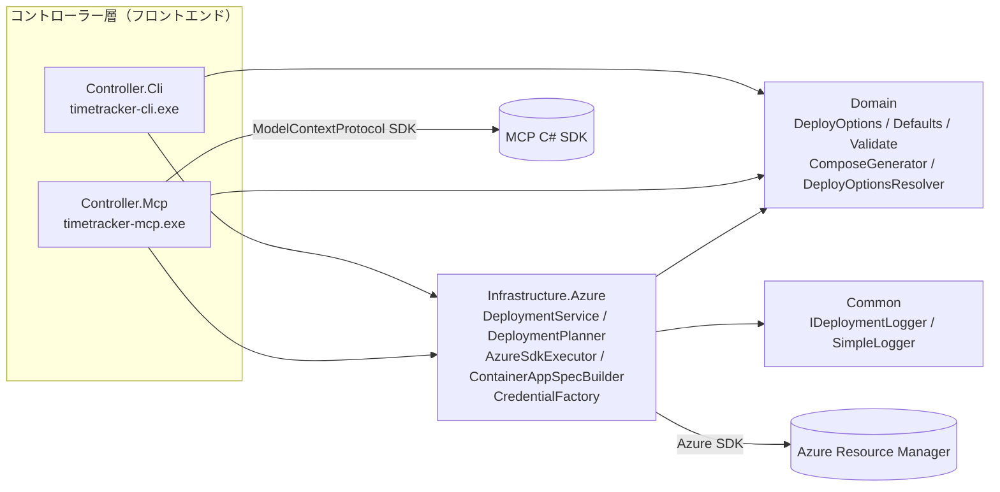

# MCP ツール設計案（Timetracker.Controller.Mcp）

- ステータス: 設計案（レビュー待ち。コード変更はまだ行っていない）
- 対象ブランチ: `MCP-Tool`
- 前提: `main`（a32cc3d, v0.6 系 / .NET 10）時点のコード

---

## 1. 目的とスコープ

### 1.1 目的
既存の CLI（`Timetracker.Controller.Cli`）と同じデプロイ機能を、**MCP（Model Context Protocol）サーバー**として公開する。Claude Code / Claude Desktop / VS Code などの MCP クライアントから、対話しながら以下を行えるようにする。

- パラメータの確認・検証（既定値、命名規則、DB 種別とタグの組み合わせなど）
- Dry-run（`docker-compose.yml` / `.env` の生成）
- Azure Container Apps へのデプロイ（計画 → 確認 → 実行の 2 段階）
- デプロイ済み環境の状態確認（URL、イメージタグ、スペック、稼働状態）

README の「将来の GUI 化に備えドメイン層とコントローラー層を分離」という方針に沿い、**CLI と並ぶもう一つのフロントエンド（コントローラー層）**として追加する。

### 1.2 スコープ外（本設計の対象としない）
- 本番環境構築（ツールの目的「検証環境の構築支援」は変えない）
- 既存 CLI にない新機能（リソース削除、スケール設定、永続ボリューム等）。削除ツールは「将来候補」として 4.9 に記載のみ
- リモート公開（Streamable HTTP + OAuth）は Phase 3 の検討事項とし、最初は **stdio（ローカル実行）** のみ

---

## 2. 現状コードの分析と MCP 化の課題

| # | 現状 | MCP 化での課題 |
|---|---|---|
| A | `AzureSdkExecutor` / `ContainerAppSpecBuilder` / `CredentialFactory` が **`Timetracker.Controller.Cli` プロジェクト内**にある | MCP プロジェクトから CLI（Exe）プロジェクトを参照するのは不適切。共有ライブラリへの切り出しが必要 |
| B | デプロイの手順（検証 → RG → Environment → DB/Redis/TT）が `Program.cs` のトップレベル文に直書き | MCP からも同じ手順を呼べるよう、アプリケーションサービスに切り出す必要がある |
| C | 既定値の解決（DB 種別に応じたタグ、アプリ名の小文字化、スペック既定値）も `Program.cs` にある | CLI と MCP で解決ロジックがずれる恐れ（No.28 と同種の問題）。共通化が必要 |
| D | `SimpleLogger` が `Console.Out`（stdout）に出力 | **stdio トランスポートでは stdout が JSON-RPC 専用**。stdout に 1 行でもログが出るとプロトコルが壊れる。ログ出力先の抽象化が必須 |
| E | `CreateOrUpdateContainerAppAsync` は戻り値なしで、エンドポイント URL はログに出すだけ | ツール結果として URL 等を構造化して返すには戻り値（結果オブジェクト）が必要 |
| F | 既存リソースの事前確認（RG/Environment のリージョン不一致、既存 DB アプリ）は「作成処理の途中」で行われる | MCP では実行前に「何が起きるか」を提示して確認を取りたい。読み取り専用の事前確認（プラン）処理が必要 |
| G | `ComposeGenerator.Validate` は最初のエラーで例外を投げる | LLM が一度で修正できるよう、全エラーを列挙できると望ましい（必須ではない） |
| H | Dry-run は `.env` をカレントディレクトリに書く | MCP サーバーのカレントディレクトリはクライアント依存で予測できない。出力先を明示指定させる必要がある |
| I | デプロイは Environment 作成を含めて数分〜10 分程度かかる | MCP クライアントのツール呼び出しタイムアウトを超える可能性。非同期ジョブ化が必要 |
| J | DB/アプリのパスワードを引数で受け取る | MCP のツール引数・結果は LLM のコンテキストに入る。秘密情報の扱いを設計する必要がある |

---

## 3. 全体アーキテクチャ

### 3.1 プロジェクト構成（案）

```
src/
  Timetracker.Common/                 (既存) ロガー抽象 + 実装
  Timetracker.Domain/                 (既存) DeployOptions, Defaults, Validate, Compose 生成
  Timetracker.Infrastructure.Azure/   (新規) Azure SDK 実行・仕様生成・認証・デプロイサービス
  Timetracker.Controller.Cli/         (既存) CLI フロントエンド（薄くなる）
  Timetracker.Controller.Mcp/         (新規) MCP サーバー フロントエンド
tests/
  Timetracker.Domain.Tests/           (既存)
  Timetracker.Controller.Cli.Tests/   (既存) CLI 固有のテストのみ残す
  Timetracker.Infrastructure.Azure.Tests/ (新規) 既存の Azure 系テストを移設
  Timetracker.Controller.Mcp.Tests/   (新規)
```

命名は既存の `Timetracker.Controller.Cli` に合わせて `Timetracker.Controller.Mcp`（アセンブリ名 `timetracker-mcp`）とする。

### 3.2 依存関係



### 3.3 MCP サーバーの実行形態
- 言語・ランタイム: C# / .NET 10（既存と同じ。ドメイン層を直接再利用できるため）
- SDK: 公式 MCP C# SDK（NuGet `ModelContextProtocol`。`Microsoft.Extensions.Hosting` 上で `AddMcpServer().WithStdioServerTransport().WithToolsFromAssembly()`）。バージョンは実装時点の最新安定版を確認して固定する
- トランスポート: **stdio**（クライアントが子プロセスとして起動）。Phase 3 で Streamable HTTP を検討
- 認証: サーバープロセスの起動時設定で決める（4.0 参照）。ローカルの `az login` 等をそのまま使えるため stdio と相性が良い

---

## 4. ツール設計

### 4.0 サーバー共通設定（起動時の環境変数／引数）

ツールの引数ではなく、MCP クライアント設定（`mcp.json` 等）でサーバー起動時に渡す。

| 設定 | 環境変数 | 既定 | 説明 |
|---|---|---|---|
| 認証モード | `TT_MCP_AUTH_MODE` | `default` | `default` / `azure-cli` / `sp-env` / `device-code` / `managed-identity`（`CredentialFactory` をそのまま使用）。資格情報はプロセス内で 1 つ作成し再利用（トークンキャッシュを活かす） |
| 既定サブスクリプション | `TT_MCP_DEFAULT_SUBSCRIPTION` | なし | ツール引数で省略された場合に使う |
| 既定リソースグループ | `TT_MCP_DEFAULT_RESOURCE_GROUP` | なし | 同上 |
| DB パスワード | `TT_MCP_DB_PASSWORD` | なし | 4.10 参照。ツール引数より優先度は低い |
| アプリパスワード | `TT_MCP_TRACKER_PASSWORD` | なし | 同上 |
| Dry-run 出力ルート | `TT_MCP_OUTPUT_ROOT` | なし | 設定時、`generate_compose` の出力先をこの配下に制限する |
| 詳細ログ | `TT_MCP_VERBOSE` | `false` | stderr / MCP ログ通知への VERBOSE 出力 |

認証モードをツール引数にしない理由: LLM が会話中に認証方式を切り替えると、意図しない資格情報でデプロイされ得るため（No.6 と同じ考え方）。

### 4.1 ツール一覧

| ツール名 | 概要 | Azure アクセス | annotations（readOnly / destructive / idempotent / openWorld） | フェーズ |
|---|---|---|---|---|
| `get_deployment_options` | 既定値・選択肢・命名規則・制約の取得 | なし | ✔ / – / ✔ / – | 1 |
| `validate_deployment` | パラメータ検証と解決済み設定の確認 | なし | ✔ / – / ✔ / – | 1 |
| `generate_compose` | Dry-run（compose / .env をローカルに出力） | なし | – / –（※上書き時のみ注意） / ✔ / – | 1 |
| `list_subscriptions` | 利用可能なサブスクリプション一覧 | 読み取り | ✔ / – / ✔ / ✔ | 1 |
| `plan_deployment` | 既存リソースを確認し実行計画を作成 | 読み取り | ✔ / – / ✔ / ✔ | 2 |
| `start_deployment` | 計画に基づきデプロイを開始（非同期ジョブ） | 書き込み | – / ✔ / – / ✔ | 2 |
| `get_deployment_status` | デプロイジョブの進捗・ログ・結果 | なし（ジョブ参照） | ✔ / – / ✔ / – | 2 |
| `get_deployment_info` | デプロイ済み環境の状態・URL | 読み取り | ✔ / – / ✔ / ✔ | 2 |
| `delete_deployment` | 環境の削除 | 書き込み | – / ✔ / ✔ / ✔ | 将来候補 |

共通の引数名は CLI オプションと 1 対 1 に対応する snake_case とする（`--tt-cpu` → `tt_cpu`）。各ツールは `outputSchema` を定義し、`structuredContent`（JSON）と人が読めるテキスト要約の両方を返す。

### 4.2 共通パラメータ（デプロイ設定）

`validate_deployment` / `generate_compose` / `plan_deployment` で共通。

| 引数 | 型 | 必須 | 既定 | CLI 対応 |
|---|---|---|---|---|
| `subscription` | string | △（Dry-run では不要※） | `TT_MCP_DEFAULT_SUBSCRIPTION` | `--subscription` |
| `resource_group` | string | △（同上） | `TT_MCP_DEFAULT_RESOURCE_GROUP` | `--resource-group` |
| `location` | string | – | `japaneast` | `--location` |
| `app_name` | string | – | `timetracker` | `--app-name` |
| `db_type` | enum `postgresql` \| `sqlserver` | – | `postgresql` | `--db-type` |
| `db_name` | string | – | `timetracker` | `--db-name` |
| `tt_tag` | string | – | DB 種別に応じた既定タグ | `--tt-tag` |
| `db_password` | string | △（4.10） | `TT_MCP_DB_PASSWORD` | `--db-password` |
| `tracker_password` | string | △（4.10） | `TT_MCP_TRACKER_PASSWORD` | `--tracker-password` |
| `tt_cpu` / `tt_memory_gi` | number | – | 1.5 / 3.0 | `--tt-cpu` / `--tt-memory` |
| `db_cpu` / `db_memory_gi` | number | – | 1.0 / 2.0 | `--db-cpu` / `--db-memory` |
| `redis_cpu` / `redis_memory_gi` | number | – | 0.5 / 1.0 | `--redis-cpu` / `--redis-memory` |

※ 現行の `Validate` は Dry-run でも subscription / resource-group を必須としている。MCP の `generate_compose` では不要にしたいが、CLI の挙動と揃えるかは要判断（7 章 Q4）。

既定値の解決は新設する `DeployOptionsResolver`（Domain）で行い、CLI と MCP が同じ結果になるようにする。

### 4.3 `get_deployment_options`
- 入力: なし
- 出力（例）:
  ```json
  {
    "db_types": ["postgresql", "sqlserver"],
    "default_tt_tags": { "postgresql": "11.0.1-linux-postgres", "sqlserver": "11.0.1-linux-mssql" },
    "defaults": { "location": "japaneast", "app_name": "timetracker", "db_name": "timetracker",
                  "tt_cpu": 1.5, "tt_memory_gi": 3.0, "db_cpu": 1.0, "db_memory_gi": 2.0,
                  "redis_cpu": 0.5, "redis_memory_gi": 1.0 },
    "app_name_rule": { "min_length": 2, "max_length": 26, "pattern": "^[a-z]([a-z0-9-]*[a-z0-9])?$", "no_double_hyphen": true },
    "resource_suffixes": ["-env", "-db", "-redis", "-tt"],
    "auth_mode": "azure-cli",
    "constraints": [
      "検証環境向け。Azure 上の DB データは永続化されない（DB コンテナ再起動で消える）",
      "SQL Server は Developer エディション（本番利用不可）",
      "Azure 上の SQL Server 構成ではサンプル DB を作成できない（空の DB を選択）",
      "Timetracker のメモリが 2Gi 以下だとサンプル DB 作成が OutOfMemory で失敗する"
    ],
    "tag_list_url": "https://hub.docker.com/r/densocreate/timetracker/tags"
  }
  ```
- すべて `Defaults` / `AppNameValidator` / `ContainerImages` から生成し、値を二重管理しない。

### 4.4 `validate_deployment`
- 入力: 4.2 の共通パラメータ
- 処理: `DeployOptionsResolver` で既定値を解決 → `AppNameValidator.GetError` → `ComposeGenerator.Validate`
- 出力:
  ```json
  {
    "valid": false,
    "errors": ["不適切な組み合わせ: db-type='sqlserver' と tt-tag='11.0.1-linux-postgres' は対応していません。..."],
    "warnings": ["db_type=sqlserver のため、Azure 上ではサンプル DB を作成できません。"],
    "resolved": { "app_name": "timetracker", "db_type": "sqlserver", "tt_tag": "11.0.1-linux-postgres", "...": "...",
                  "db_password": "********", "tracker_password": "********" },
    "resource_names": { "environment": "timetracker-env", "tt": "timetracker-tt", "db": "timetracker-db", "redis": "timetracker-redis" }
  }
  ```
- 検証エラーは MCP のプロトコルエラーではなく **ツール結果（`isError: true` もしくは `valid: false`）** として返し、LLM が自己修正できるようにする。
- 警告（エラーではないが注意すべき点）は新設の `DeploymentAdvisor`（Domain、純粋関数）で生成する: SQL Server のサンプル DB 制約、`tt_memory_gi <= 2` のメモリ不足、既定外タグ（7.x 系など）の利用。

### 4.5 `generate_compose`（Dry-run）
- 入力: 共通パラメータ + `output_dir`（必須・絶対パス）+ `overwrite`（bool, 既定 false）
- 処理: 検証 → `ComposeGenerator.GenerateCompose` / `GenerateEnv` → `output_dir` に `docker-compose.yml` と `.env` を書き込み
- 出力: 書き込んだファイルのパス、`docker-compose.yml` の内容（秘密情報を含まない）、次の手順（`docker compose up -d`、`http://localhost:8080`）
- `.env` は **内容を返さない**（パスワードを含むため）。パスのみ返す。
- 既存ファイルがあり `overwrite=false` の場合はエラーで返す（上書きで以前の `.env` を失わないため）。
- `TT_MCP_OUTPUT_ROOT` 設定時は、その配下以外への書き込みを拒否する。

### 4.6 `list_subscriptions`
- 入力: なし
- 出力: `[{ "subscription_id", "display_name", "state", "tenant_id" }]`
- 目的: ユーザーが ID を覚えていなくても「どのサブスクリプションに入れますか？」と会話で選べるようにする。

### 4.7 `plan_deployment` / `start_deployment`（2 段階実行）

DB の再デプロイはデータ消失を伴うため、**計画（読み取りのみ）→ ユーザー確認 → 実行**の 2 段階とする。

#### `plan_deployment`
- 入力: 4.2 の共通パラメータ
- 処理（すべて読み取り。`DeploymentPlanner` を新設し `GetIfExistsAsync` で確認）:
  1. 検証（`validate_deployment` と同じ）
  2. リソースグループ: 存在有無とリージョン（不一致なら警告。現行 `EnsureResourceGroupAsync` と同じ判定）
  3. Environment: 存在有無とリージョン（不一致なら **ブロッカー**。現行 `EnsureContainerAppEnvAsync` と同じ判定）
  4. `-db` / `-redis` / `-tt` 各 Container App: 作成 or 更新
  5. `-db` が既存 → データ消失の警告（`WarnIfDbAppExistsAsync` と同じ内容）
- 出力:
  ```json
  {
    "plan_id": "pln_7f3c...",
    "expires_at": "2026-10-14T10:15:00Z",
    "blockers": [],
    "actions": [
      { "resource": "resource_group", "name": "rg-tt-verify", "action": "use_existing" },
      { "resource": "environment", "name": "timetracker-env", "action": "create" },
      { "resource": "container_app", "name": "timetracker-db", "action": "update", "data_loss": true },
      { "resource": "container_app", "name": "timetracker-redis", "action": "update" },
      { "resource": "container_app", "name": "timetracker-tt", "action": "update" }
    ],
    "warnings": ["DB アプリ 'timetracker-db' は既に存在します。更新すると DB のデータは失われます。"],
    "requires_data_loss_ack": true,
    "estimated_duration": "5〜10 分（Environment を新規作成する場合）"
  }
  ```
- 計画はサーバープロセス内のメモリに保持（解決済みの `DeployOptions` を含む。パスワードもメモリ内のみ）。有効期限は 15 分。

#### `start_deployment`
- 入力: `plan_id`（必須）、`acknowledge_data_loss`（bool。計画が `requires_data_loss_ack=true` の場合は `true` 必須）
- **パラメータは受け取らない**。計画と異なる内容で実行されることを防ぐため、実行内容は `plan_id` に紐づく設定だけで決まる。
- 処理:
  1. 計画の有効期限・ブロッカーを確認
  2. 実行直前に再度読み取りを行い、計画時から状態が変わっていれば（例: 計画時になかった DB アプリが作成されていた）中止して再計画を促す
  3. 同じ `subscription/resource_group/app_name` のジョブが実行中なら拒否（二重実行防止）
  4. バックグラウンドで `DeploymentService.DeployAsync` を開始し、即座に `job_id` を返す
- 出力: `{ "job_id": "job_...", "status": "running", "poll_hint": "get_deployment_status を 15〜30 秒間隔で呼ぶ" }`
- クライアントが進捗通知（`progressToken`）を送ってきた場合は、ステップごとに `notifications/progress` も送る。

> 代替案: 1 回のツール呼び出しで完了まで待つ同期方式。実装は単純だが、Environment 新規作成時はクライアントのタイムアウトを超える恐れがあるため不採用。MCP 仕様の Tasks（長時間処理の標準化、2025-11-25 版で実験的）が C# SDK とクライアントで安定したら移行を検討する。

### 4.8 `get_deployment_status`
- 入力: `job_id`、`log_offset`（int, 任意。差分取得用）
- 出力:
  ```json
  {
    "job_id": "job_...",
    "status": "running",            // queued | running | succeeded | failed | canceled
    "current_step": { "index": 3, "total": 5, "name": "DB アプリを作成/更新中 (timetracker-db)" },
    "logs": [ { "level": "info", "message": "Container Apps Environment を作成: timetracker-env", "at": "..." } ],
    "next_log_offset": 12,
    "result": null,                 // 成功時: { "endpoint": "https://timetracker-tt.xxx.japaneast.azurecontainerapps.io", "apps": [...] }
    "error": null,                  // 失敗時: メッセージ（verbose 時は詳細）
    "device_code_message": null     // device-code 認証時、ユーザーに表示すべきメッセージ
  }
  ```
- ステップ: ① 検証 ② リソースグループ ③ Environment ④ DB ⑤ Redis ⑥ Timetracker（`total` は実装で確定）
- ジョブ情報はプロセス内メモリ保持。プロセスが終了したら失われるが、Azure 側の状態は `get_deployment_info` で確認できる。

### 4.9 `get_deployment_info`
- 入力: `subscription`、`resource_group`、`app_name`
- 出力: 各リソースの存在有無、`provisioningState`、稼働状態、イメージ（タグ）、CPU/メモリ、最新リビジョン、Timetracker の FQDN（`https://...`）
- 用途: 「さっきデプロイした環境の URL は？」「今のタグは？」への回答、ジョブ消失後の状態確認。

#### 将来候補: `delete_deployment`
CLI に削除機能がないため Phase 1〜2 では実装しない。追加する場合は `plan_deployment` と同様に「削除計画 → `plan_id` + 確認フラグで実行」とし、削除対象は本ツールの命名規則（`{app}-env/-db/-redis/-tt`）に一致するリソースに限定する（リソースグループごとの削除はしない）。

### 4.10 秘密情報（パスワード）の扱い

ツール引数と結果は LLM のコンテキスト（＝会話ログ）に残る。そのため以下の優先順位で値を決める。

1. ツール引数 `db_password` / `tracker_password`（明示的に渡された場合。会話に残ることをサーバーの instructions で注意喚起）
2. サーバー起動時の環境変数 `TT_MCP_DB_PASSWORD` / `TT_MCP_TRACKER_PASSWORD`（**推奨**。会話に値が出ない）
3. どちらもない場合 → 検証エラーとして返し、上記の設定方法を案内する

共通ルール:
- ツールの結果・ログ・エラーメッセージにパスワードを含めない（`resolved` では `********` にマスク）
- `.env` の内容は返さない（4.5）
- 自動生成（サーバー側で強いパスワードを作り、ローカルファイルに保存してパスのみ返す）は便利だが、アプリパスワードをユーザーに伝える手段が必要になるため Phase 2 以降の検討事項とする（7 章 Q1）

---

## 5. MCP サーバーのその他の要素

### 5.1 サーバー instructions
初期化時の `instructions` に、ツールを使う前提知識を記載する（LLM が毎回 README を読まなくてよいように）。

- 本ツールは検証環境向け。Azure 上の DB は再デプロイで消えること
- デプロイは必ず `plan_deployment` → ユーザー確認 → `start_deployment` の順。`requires_data_loss_ack` の場合はユーザーの明示同意を得てから `acknowledge_data_loss=true` にすること
- `start_deployment` 後は `get_deployment_status` を間隔をあけて呼ぶこと
- パスワードは環境変数での設定を推奨すること
- SQL Server + Azure ではサンプル DB 不可、Timetracker のメモリは 3Gi 以上推奨

### 5.2 Resources（任意・Phase 3）
- `timetracker://docs/constraints`: 「本ツールの目的と注意事項」
- `timetracker://docs/rbac`: 必要な RBAC ロールとリソースプロバイダー登録手順
- `timetracker://deployments/{subscription}/{rg}/{app}`: `get_deployment_info` と同内容

### 5.3 Prompts（任意・Phase 3）
- `deploy-timetracker`: サブスクリプション選択 → DB 種別 → 検証 → 計画 → 実行までを案内する定型プロンプト
- `local-dry-run`: ローカル Docker での動作確認手順

### 5.4 ログ
- stdout には一切書かない（stdio トランスポートの JSON-RPC 専用）
- 出力先は (1) stderr、(2) MCP の `notifications/message`（クライアントが `logging/setLevel` した場合）、(3) ジョブログ（`get_deployment_status` で取得）
- Generic Host の既定コンソールロガーも stderr 出力に設定する（`LogToStandardErrorThreshold = Trace`）

### 5.5 エラー処理
| 種別 | 返し方 |
|---|---|
| 入力検証エラー（`ArgumentException`） | ツール結果 `isError: true` + 日本語メッセージ（既存メッセージをそのまま利用） |
| Azure 認証エラー（`AuthenticationFailedException` 等） | ツール結果 `isError: true` + 認証モードごとの対処（`az login` 等） |
| Azure API エラー（`RequestFailedException`） | ステータス・エラーコード・メッセージを返す（例: `ManagedEnvironmentInvalidRequest`） |
| 未知の plan_id / job_id | ツール結果 `isError: true` |
| 想定外例外 | ツール結果 `isError: true`。スタックトレースは `TT_MCP_VERBOSE=true` 時に stderr のみ |

### 5.6 同時実行・キャンセル
- 同一 `subscription/resource_group/app_name` のデプロイは同時に 1 つまで
- `notifications/cancelled` で `start_deployment` の呼び出し自体はキャンセルできるが、開始済みジョブは Azure 側の操作を途中で止めると中途半端な状態になるため、ステップ境界でのみ停止する（Phase 2 では「キャンセル不可」としてもよい）

---

## 6. 共有レイヤーのリファクタリング（Phase 0）

MCP プロジェクト追加の前提として、**CLI の挙動を変えずに**以下を行う。既存テストが全件成功することを確認しながら進める。

| # | 変更 | 対応する課題 |
|---|---|---|
| R1 | `Timetracker.Infrastructure.Azure` プロジェクトを新設し、`AzureSdkExecutor` / `ContainerAppSpecBuilder` / `CredentialFactory` を移動。Azure 系テストも新テストプロジェクトへ移動 | A |
| R2 | `Timetracker.Common` に `IDeploymentLogger`（Info / Verbose / Warn / Success / Error / Exception）を追加し、`SimpleLogger` が実装。Infrastructure は `IDeploymentLogger` に依存 | D |
| R3 | `DeployOptionsResolver`（Domain）を新設し、`Program.cs` の既定値解決（タグ、小文字化、スペック既定値）を移動。CLI はこれを呼ぶ | C |
| R4 | `DeploymentService.DeployAsync(DeployOptions, IProgress<DeploymentProgress>?, CancellationToken)` → `DeploymentResult`（エンドポイント URL、各アプリ名）を新設。`Program.cs` の手順と `CreateOrUpdateContainerAppAsync` の戻り値をこれに置き換え | B, E |
| R5 | `DeploymentPlanner.PlanAsync(DeployOptions, CancellationToken)` → `DeploymentPlan` を新設（読み取りのみ）。リージョン判定は `AzureSdkExecutor` と共通の関数にする | F |
| R6 | Azure 呼び出しに `CancellationToken` を通す | 5.6 |
| R7 | （任意）`ComposeGenerator.GetValidationErrors(DeployOptions)` → `IReadOnlyList<string>` を追加し、`Validate` はその先頭で例外を投げる形にする | G |
| R8 | （任意）`DeploymentAdvisor`（Domain）で警告を生成。CLI でも同じ警告を表示できる | 4.4 |

---

## 7. 決めていただきたい事項（オープンクエスチョン）

| # | 論点 | 案 | 推奨 |
|---|---|---|---|
| Q1 | パスワードの渡し方 | (a) 引数のみ / (b) 環境変数のみ / (c) 両方（環境変数推奨） / (d) 自動生成 | (c)。(d) は Phase 2 以降 |
| Q2 | デプロイの実行方式 | (a) 非同期ジョブ（start + status） / (b) 同期（完了まで待つ） | (a) |
| Q3 | 削除ツール | (a) 実装しない / (b) 2 段階確認付きで実装 | 当面 (a) |
| Q4 | Dry-run での subscription / resource_group | (a) CLI と同じく必須 / (b) MCP では不要 | (b)（CLI も合わせて不要にするかは別途） |
| Q5 | 想定クライアント | Claude Code / Claude Desktop / VS Code（GitHub Copilot） / その他 | 動作確認対象を決めたい |
| Q6 | リモート公開（Streamable HTTP + 認証、Container Apps 上でホスト + Managed Identity） | 必要か | 当面 stdio のみ |
| Q7 | 配布形態 | (a) CLI と同じ単一ファイル EXE を Release に追加 / (b) NuGet の .NET ツール（MCP サーバーパッケージ）として公開し `dnx` で起動 / (c) 両方 | (a) から開始 |

---

## 8. 実装フェーズ案

| フェーズ | 内容 | 完了条件 |
|---|---|---|
| Phase 0 | 6 章のリファクタリング（R1〜R6） | CLI の挙動変化なし。既存テスト全件成功。CI 成功 |
| Phase 1 | `Timetracker.Controller.Mcp` 新設（stdio）。`get_deployment_options` / `validate_deployment` / `generate_compose` / `list_subscriptions` | MCP Inspector と Claude Code で呼び出し確認。生成ファイルで `docker compose up` が成功 |
| Phase 2 | `plan_deployment` / `start_deployment` / `get_deployment_status` / `get_deployment_info`、ジョブ管理、進捗通知 | Azure（japaneast）で新規・再デプロイ（データ消失確認あり）が成功し、URL が返る |
| Phase 3 | 配布（release.yml に MCP の publish を追加）、README に MCP の章を追加、Resources / Prompts、HTTP トランスポート検討 | Release に `timetracker-mcp-vX.Y.Z.zip` が出る |

---

## 9. テスト方針

- **単体テスト**（xUnit v3 / FluentAssertions / Moq。既存と同じ構成）
  - ツールハンドラ: 引数 → `DeployOptions` 変換、既定値解決、マスク処理、エラー時の `isError`
  - `DeploymentPlanner`: 既存の `AzureSdkExecutorTests` と同様に `ArmClient` をモックし、create / update / blocker / data_loss の判定を検証
  - ジョブ管理: 二重実行の拒否、計画の有効期限切れ、状態変化時の中止
  - パスワードが結果・ログに含まれないこと（既存 No.5 のテストと同じ考え方）
- **プロトコル結合テスト**: SDK のクライアントとサーバーをインメモリのストリームで接続し、`tools/list` のスキーマ・annotations、`tools/call` の結果を検証。stdout にログが混入しないことも確認
- **手動確認**: MCP Inspector、Claude Code（`claude mcp add`）、Claude Desktop での対話デプロイ。Azure 上の確認は既存レビュー表と同様に結果を記録する

---

## 10. クライアント設定例（Phase 1 完了後のイメージ）

Claude Code:
```powershell
claude mcp add timetracker-deploy `
  --env TT_MCP_AUTH_MODE=azure-cli `
  --env TT_MCP_DEFAULT_SUBSCRIPTION=<サブスクリプションID> `
  -- C:\tools\timetracker-mcp.exe
```

VS Code（`.vscode/mcp.json`）:
```json
{
  "servers": {
    "timetracker-deploy": {
      "type": "stdio",
      "command": "C:\\tools\\timetracker-mcp.exe",
      "env": {
        "TT_MCP_AUTH_MODE": "azure-cli",
        "TT_MCP_DB_PASSWORD": "${input:dbPassword}",
        "TT_MCP_TRACKER_PASSWORD": "${input:trackerPassword}"
      }
    }
  },
  "inputs": [
    { "id": "dbPassword", "type": "promptString", "description": "DB パスワード", "password": true },
    { "id": "trackerPassword", "type": "promptString", "description": "Timetracker パスワード", "password": true }
  ]
}
```

想定される対話例:
1. ユーザー「検証用に Timetracker を Azure に立てたい。SQL Server で」
2. LLM → `get_deployment_options` → `list_subscriptions` → サブスクリプションを確認
3. LLM → `validate_deployment` → 「SQL Server では Azure 上でサンプル DB が作れません」と警告を伝える
4. LLM → `plan_deployment` → 作成されるリソースと所要時間を提示し、ユーザーの承認を得る
5. LLM → `start_deployment` → `get_deployment_status` を繰り返し → 完了後 URL を提示
