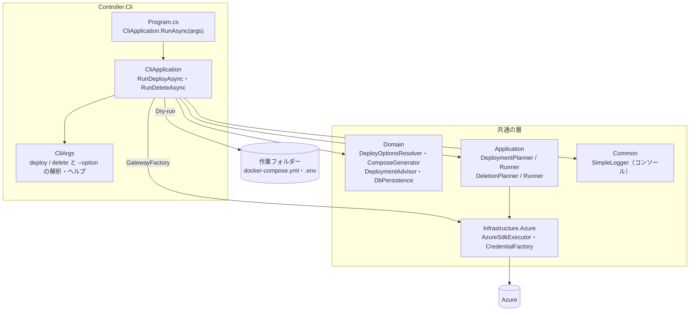
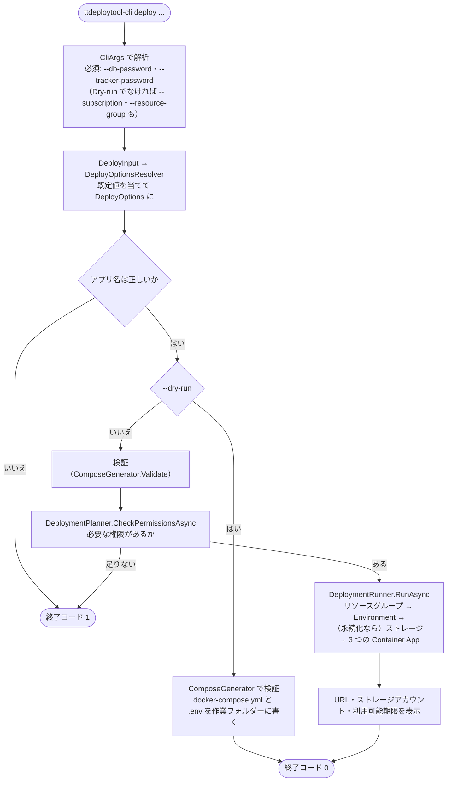
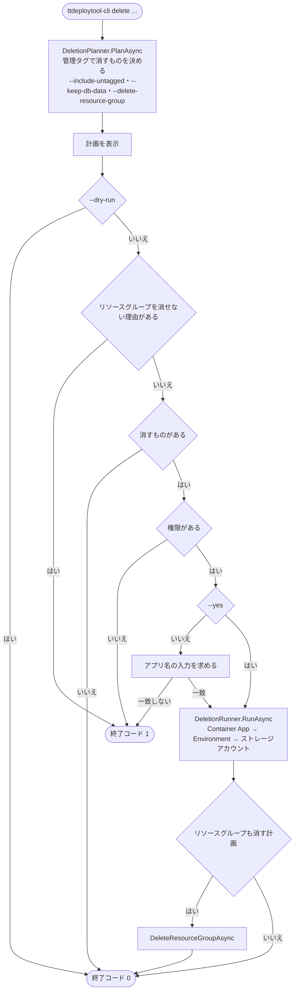

# TTDeployTool CLI の構造

- 対象: `feature/desktop-app` の 2026-10-28 時点のコード
- 関連: [共通部分の構造](../common/README.md)（層・ドメインモデル・Azure に作るもの）・[`cli-delete.md`](cli-delete.md)（delete の詳細設計）・リポジトリの README（オプションの一覧）
- 図は Mermaid で書いています（GitHub と、Mermaid に対応したエディターで図として表示されます）。コードの構成を変えたら、この図も直します

CLI（`ttdeploytool-cli`）は、引数を読んで、共通の層の Planner と Runner を直接呼ぶ、いちばん薄い入り口です。計画を保管せず、ジョブも作らず、1 回の実行の中で確かめてから順に実行し、終わったら終了コード（成功 0・失敗 1）を返します。

## 1. プロジェクトの構成

- Azure の操作は `GatewayFactory`（既定は `AzureSdkExecutor` と、`--auth-mode` で作る資格情報）で作るため、テストでは偽物に差し替えます
- 入出力（標準出力・標準エラー・標準入力・作業フォルダー・時刻）は `RunAsync` の引数で受けるため、テストでコンソールを使わずに確かめられます

## 2. deploy の流れ

## 3. delete の流れ

## 4. MCP サーバー・デスクトップアプリとの違い

- 計画の保管（`IPlanStore`）とジョブ（`JobManager`）を使いません。計画を作ってから実行までが 1 回の実行の中で続くため、「実行の直前に計画し直して比べる」処理は要りません
- 確認は、計画をコンソールに表示し、アプリ名を入力してもらう方法です（CI などでは `--yes` で省きます）
- Azure の資格情報は `--auth-mode`（`default`・`azure-cli`・`sp-env`・`device-code`・`managed-identity`。既定は `DefaultAzureCredential`）で選びます
