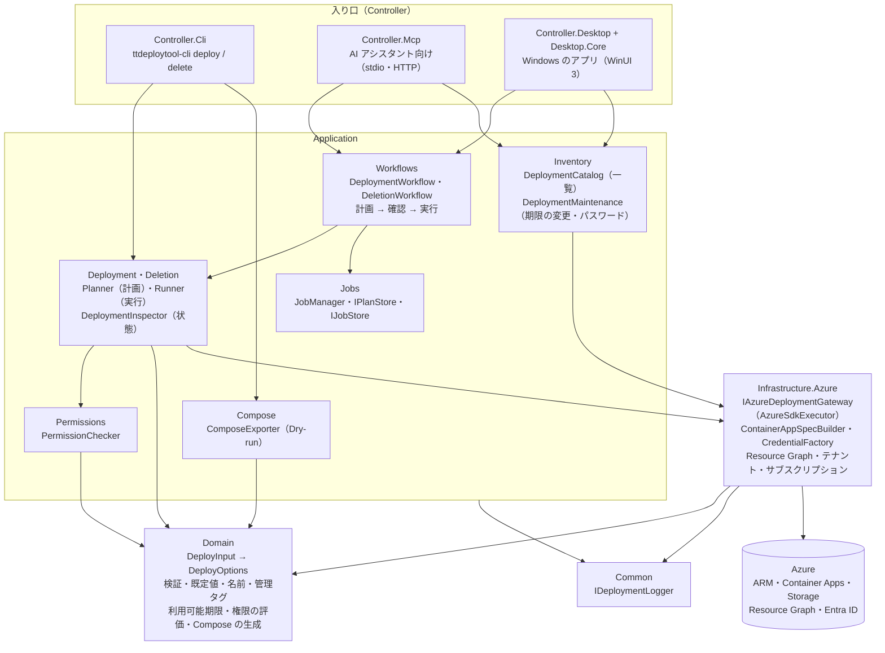
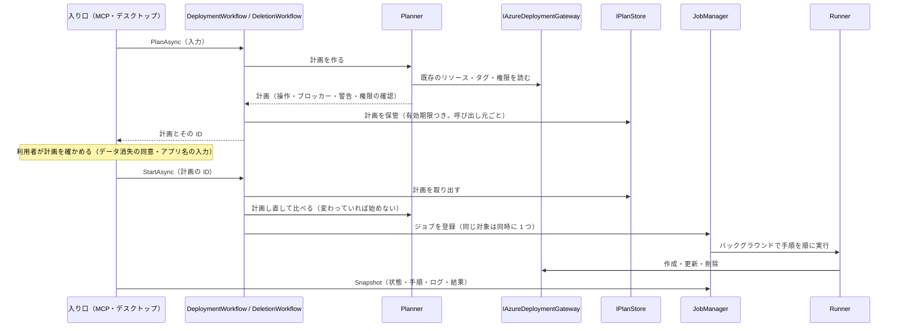
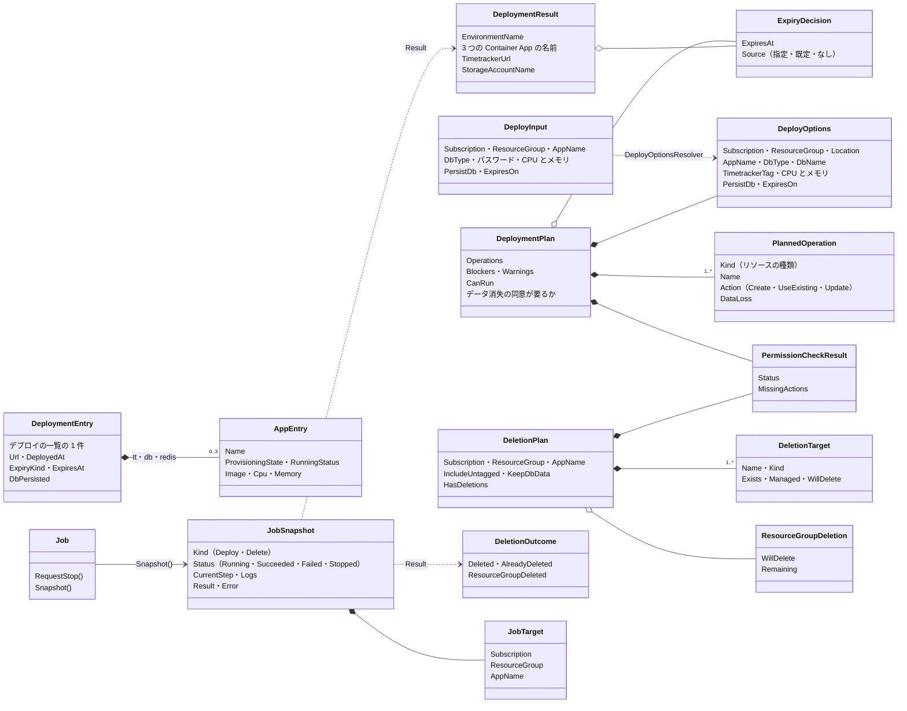
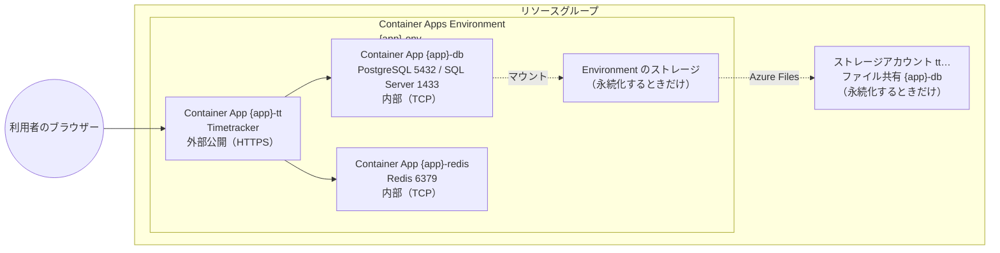

# TTDeployTool 共通部分の構造

- 対象: `feature/desktop-app` の 2026-10-28 時点のコード
- 関連: [CLI の構造](../cli/README.md)・[MCP サーバーの構造](../mcp/README.md)・[デスクトップの構造](../desktop/README.md)・[`MCP_TOOL_DESIGN.md`](../../MCP_TOOL_DESIGN.md)（全体設計。3.2 依存関係・3.4 Application を共有する方針）・[`db-persistence.md`](db-persistence.md)（DB のデータの永続化）・[`resource-group-deletion.md`](resource-group-deletion.md)（リソースグループの削除）
- 図は Mermaid で書いています（GitHub と、Mermaid に対応したエディターで図として表示されます）。コードの構成を変えたら、この図も直します

TTDeployTool には、利用者の入り口が 3 つ（CLI・MCP サーバー・デスクトップアプリ）あり、どれも同じ Domain・Application・Infrastructure.Azure を使います。入り口が違っても、同じ入力からは同じリソースを、同じ名前と管理タグで作ります。

## 1. 全体の構成と依存の向き

矢印は「使う」向きです。入り口（Controller）は利用者とのやり取りだけを持ち、検証・計画・実行は共通の層に置きます。

| プロジェクト | 役割 | 持たないもの |
|---|---|---|
| `TTDeployTool.Domain` | 入力の既定値と検証、リソースの名前（`ResourceNaming`）、管理タグ（`ManagedTags`）、利用可能期限（`DeploymentExpiry`）、権限の評価（`PermissionEvaluator`）、docker-compose.yml と .env の生成（`ComposeGenerator`） | Azure の SDK・入出力 |
| `TTDeployTool.Application` | 計画（何を作る・変える・消すか、ブロッカーと警告、権限の確認）と実行、計画 → 確認 → 実行の流れ（`Workflows`）、計画とジョブの保管（`IPlanStore`・`JobManager`）、デプロイの一覧 | 画面・引数・トランスポート |
| `TTDeployTool.Infrastructure.Azure` | Azure の操作の窓口 `IAzureDeploymentGateway` とその実装（`AzureSdkExecutor`）、Container App の定義（`ContainerAppSpecBuilder`）、資格情報（`CredentialFactory`）、Resource Graph での一覧の読み取り | 計画の判断 |
| `TTDeployTool.Common` | ログの窓口（`IDeploymentLogger`）と、コンソール向けの実装 | — |

補足: Azure の窓口のインターフェース（`IAzureDeploymentGateway`）は Infrastructure.Azure の側にあり、Application は Infrastructure.Azure を参照しています（依存はすべて内向きではありません）。テストでは、この窓口を偽物に差し替えます。

## 2. 計画 → 確認 → 実行

MCP サーバーとデスクトップアプリは `Workflows` を通して、計画を保管し、利用者が確かめた後に、実行の直前に計画を作り直して比べてから始めます。CLI は Planner と Runner を直接呼び、コンソールで確かめます（[CLI の構造](../cli/README.md)）。

## 3. ドメインモデル

利用者の入力 `DeployInput` は、既定値と検証を経て `DeployOptions` になります。計画（`DeploymentPlan`・`DeletionPlan`）は実行の前に利用者が確かめる単位で、ジョブ（`Job`）はその実行です。リソースの名前は `ResourceNaming`（`{app}-env`・`-db`・`-redis`・`-tt`）、本ツールで作ったものかは管理タグ `managed-by=ttdeploytool` で決めます。

## 4. Azure に作るもの

1 つのデプロイ（アプリ名 `{app}`）は、1 つのリソースグループの中の次のリソースです。DB と Redis は Environment の中だけで TCP で受け、Timetracker だけを外に公開します。`--persist-db`（永続化）を選ぶと、DB のデータをストレージアカウントのファイル共有に置きます（[`db-persistence.md`](db-persistence.md)）。

| 管理タグ | 値 | 付けるもの | 使い道 |
|---|---|---|---|
| `managed-by` | `ttdeploytool` | 作ったリソースすべてと、デプロイのときに作ったリソースグループ | 本ツールで作ったものかの判断。削除は、既定でこのタグと `tt-app-name` のあるものだけを消す（`--include-untagged` で無いものも）。リソースグループは、このタグがあるときだけ消せる |
| `tt-app-name` | アプリ名 | 作ったリソースすべて（リソースグループには付けない。複数のアプリ名で共有できるため） | どのデプロイのリソースかの判断（デプロイの一覧で束ねる） |
| `tt-deployed-at` | デプロイした日時（UTC） | 3 つの Container App・Environment・ストレージアカウント | デプロイの一覧の表示 |
| `tt-expires-at` | 利用可能期限（UTC）か `none` | 3 つの Container App・Environment・ストレージアカウント | 期限の前の通知と、期限での削除（デスクトップアプリ） |

削除は、本ツールで作ったもの（管理タグのあるもの）だけを消し、リソースグループは既定では残します。リソースグループも消すのは、利用者が選び、本ツールが作ったもので、消した後に空になる場合だけです（[`resource-group-deletion.md`](resource-group-deletion.md)）。

## 5. 入り口ごとの違い

| 項目 | CLI | MCP サーバー | デスクトップアプリ |
|---|---|---|---|
| 使う人 | コマンドを使う開発者・CI | AI アシスタントの利用者 | CLI・AI を使わない利用者 |
| 確認の方法 | 計画を表示して、アプリ名を入力（`--yes` で省略） | 計画の ID を返し、利用者が確かめてから `start_*` | 画面で計画を見て、同意・アプリ名を入力 |
| 実行 | その場で順に実行（終わるまで待つ） | ジョブ（`get_job_status` で状態を読む） | ジョブ（同時に 2 つまで・予定・停止。アプリを終了しても予定と記録を残す） |
| Azure の資格情報 | `--auth-mode`（既定は DefaultAzureCredential） | stdio は PC の資格情報、HTTP はサーバーの ID か利用者本人（OBO） | WAM で Entra ID にサインイン |
| 構造の文書 | [cli/README.md](../cli/README.md) | [mcp/README.md](../mcp/README.md) | [desktop/README.md](../desktop/README.md) |
