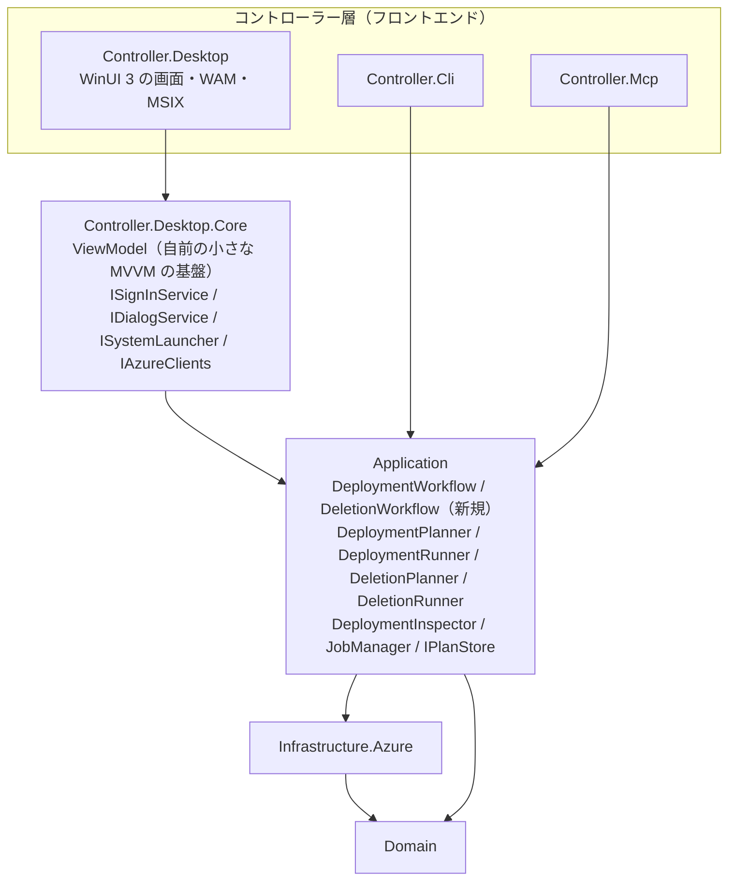
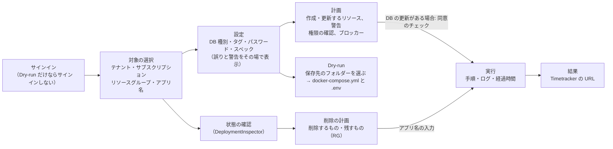

# 詳細設計: ストア配布できるデスクトップアプリ（Phase 5）

- 対象ブランチ: `feature/desktop-app`
- 全体設計: `docs/ROADMAP.md` の「2. ストア配布できるデスクトップアプリ」、`docs/MCP_TOOL_DESIGN.md`（3.2 依存関係、3.4 Application を共有する方針、4.7・4.12 計画 → 確認 → 実行、4.10 パスワードの扱い）
- 前の段階: `docs/design/mcp-phase3b.md`（計画ストア・ジョブ）、`docs/design/mcp-phase3c.md`（削除の計画と実行）
- 状況: 10 の論点はオーナーの回答で決定した（WinUI 3・限定公開で始める・マルチテナントのアプリ登録・パスワードは保存しない）。一次情報の確認日は 2026-10-17
- 中断と再開: 5a の途中で中断し（オーナーの指示）、DB データの永続化オプション（`docs/design/db-persistence.md`）のマージの後に再開した。永続化の扱いは 7.1 に反映した

## 1. 目的
CLI や AI アシスタントを使わない利用者が、画面の操作で次を行えるようにする。Microsoft Store から導入・更新できるようにする。
- Azure へのサインインと、サブスクリプションの選択
- デプロイ（計画 → 確認 → 実行。進み具合の表示）
- デプロイ済みの環境の状態の確認（URL、イメージ、稼働状態）
- 削除（計画 → アプリ名の入力 → 実行）
- ローカル検証（Dry-run）の `docker-compose.yml` と `.env` の生成と保存

CLI・MCP サーバーと同じアプリケーション層（`Timetracker.Application`）の上に、フロントエンドの一つとして載せる（README の「将来の GUI 化に備え、ドメイン層とコントローラー層を分離」の方針）。

## 2. スコープ
| 項目 | Phase 5 |
|---|---|
| 計画 → 確認 → 実行の安全策を Application に移す（MCP の挙動は変えない） | ✔（5a） |
| 画面の状態と操作（ViewModel）。UI のフレームワークに依存しないライブラリにする | ✔（5a） |
| Windows のデスクトップアプリ（画面、サインイン、MSIX） | ✔（5b） |
| CI でのビルドとテスト、リリースでの配布物 | ✔（5b・5c） |
| Microsoft Store への提出 | ✔（5c。初回の提出は利用者が Partner Center で行う） |
| macOS / Linux 版 | ✘（Q1 で WinUI 3 に決定したため対象外） |
| 認証モードの選択（`azure-cli` / `sp-env` など） | ✘（画面では対話サインインだけにする。4.1） |
| HTTP 版の MCP サーバーへの接続（サーバー経由の操作） | ✘（ROADMAP の 5. WebAPI のフロントエンドの後に検討する） |

## 3. 構成
### 3.1 UI のフレームワークの比較
| | WinUI 3（Windows App SDK） | .NET MAUI | Avalonia UI |
|---|---|---|---|
| 対象 OS | Windows 10 1809 以降のみ | Windows（WinUI 3 の上）、macOS（Mac Catalyst）、iOS、Android。**Linux は無い** | Windows、macOS、Linux、モバイル、WASM |
| 最新の安定版（2026-10） | Windows App SDK 2.5.1（2026-09-16） | .NET 10 の MAUI（サポートは **2027-05-11 まで**。後継の版が出て 6 か月で終わる） | 12.1.4 |
| Store での配布 | MSIX が既定（単一プロジェクト MSIX）。Microsoft Learn に GitHub Actions でのビルドの例がある | MSIX を `dotnet publish` で作れる。`msstore` CLI が対応 | 公式のツール Parcel で MSIX を作れるが、CI で使うには有償のプラン。自前で `makeappx` を使う方法もある |
| テスト | ViewModel を分ければ Linux でもテストできる。画面のテストは Windows だけ | WinUI 3 と同じ | ViewModel に加え、画面もヘッドレスでテストできる（`Avalonia.Headless.XUnit`） |
| サインイン（WAM） | ウィンドウハンドルを `WinRT.Interop.WindowNative.GetWindowHandle` で取れる | Windows ではできる。macOS は別の作り込みが要る | Windows ではウィンドウハンドルを取れる。macOS・Linux はブラウザーでのサインイン |
| 提供元 | Microsoft | Microsoft | OSS（MIT） |

**推奨: WinUI 3**。対象を Windows と Microsoft Store に絞るなら、MSIX と Store への提出・WAM でのサインインが公式の手順どおりに作れて、手順が一番少ない。MAUI はサポート期間が短く（.NET の版ごとに作り直しが要る）、Windows だけなら WinUI 3 に対する利点が無い。macOS・Linux も対象にするなら Avalonia を選ぶ。→ **WinUI 3 に決定**（10 の Q1）。

### 3.2 プロジェクト構成（WinUI 3 の場合）
```
src/
  Timetracker.Application/              (既存) 計画 → 確認 → 実行のワークフローを追加（4.2）
  Timetracker.Controller.Desktop.Core/  (新規・net10.0) ViewModel、画面から使うサービスのインターフェース。UI のフレームワークに依存しない
  Timetracker.Controller.Desktop/       (新規・net10.0-windows10.0.19041.0) WinUI 3 の画面、サインイン（WAM）、ファイルの選択、MSIX
tests/
  Timetracker.Controller.Desktop.Core.Tests/  (新規) ViewModel のテスト（Linux でも動く）
```



- 画面（XAML）には処理を書かず、ViewModel のプロパティとコマンドに結び付けるだけにする。分岐のある処理はすべて `Desktop.Core` か Application に置き、テストする
- MVVM の基盤（`ObservableObject` / `AsyncCommand`）は、CommunityToolkit.Mvvm を使わず小さな自前のクラスにする。ソース生成のコードが分岐網羅率の測定に入らないようにするため（5a で決めた）。WinUI 3 の `x:Bind` は `INotifyPropertyChanged` と `ICommand` だけを使うので、機能の差は無い
- `Timetracker.Controller.Desktop`（WinUI 3）は `Timetracker.sln` に入れない。Windows でしかビルドできず、Linux の開発環境で `dotnet build Timetracker.sln` が失敗するため。`Timetracker.Desktop.slnx`（ソリューションファイル）に分け、CI の Windows のジョブでビルドする。`Desktop.Core` とそのテストは `Timetracker.sln` に入れる
- 依存の向きは既存と同じ（コントローラー層 → アプリケーション層 → インフラストラクチャ層 → ドメイン層）

## 4. Application の変更（Phase 5a）
### 4.1 現状の課題
計画 → 確認 → 実行の安全策のうち、次は MCP のツール（`DeploymentJobTools` / `DeletionJobTools`）の中にあり、デスクトップアプリから使えない。同じ規則を二重に書くと、片方だけ直す不具合が起きる（No.28 と同じ種類の問題）。
- 計画を保存し、`plan_id` を発行する（ブロッカーがあれば発行しない）
- 実行の直前に計画を作り直し、操作の一覧が変わった・ブロッカーができた場合は実行しない
- DB を更新する計画では、データ消失への同意が無ければ実行しない（このとき計画は使用済みにしない）
- 削除では、計画のアプリ名と一致する確認の入力が無ければ実行しない（このとき計画は使用済みにしない）
- 同じ対象のジョブが実行中なら、新しいジョブを始めない
- 削除の計画の警告（DB のデータが失われる、管理タグの無いものがある）と、権限が足りない場合のブロッカーの文
- 所要時間の目安（Environment を作るかどうか）

### 4.2 ワークフロー（新規）
| クラス | 公開する操作 | 内容 |
|---|---|---|
| `DeploymentWorkflow` | `PlanAsync(DeployOptions)` → `DeploymentPlanTicket`（計画、`PlanId`、`ExpiresAt`、所要時間の目安） | 計画を作り、実行できれば保存する |
| | `StartAsync(planId, acknowledgeDataLoss)` → `Job` | 4.1 の確認をして、ジョブを始める。実行できない理由は `WorkflowException`（理由の種類と、利用者に見せる文） |
| `DeletionWorkflow` | `PlanAsync(subscription, resourceGroup, appName, includeUntagged)` → `DeletionPlanTicket`（計画、ブロッカー、警告、`PlanId`） | 同上 |
| | `StartAsync(planId, confirmAppName)` → `Job` | 同上。削除の結果は既存の `DeletionJobResult` と同じ内容を Application に移す |

- 呼び出し元（`ICallerContext`）、計画ストア、ジョブ管理、Azure の操作の作り方（`Func<IDeploymentLogger, IAzureDeploymentGateway>`）をコンストラクターで受け取る
- MCP だけの規則（`server` 方式で操作してよいリソースグループ、リソースグループを作れない設定、計画を作った方式（`server` / `user`））は、ワークフローに渡す「追加の確認」（`IPlanGuard`: 計画にブロッカーを足す）として MCP 側に残す。MCP の `IdentityPlan` も計画に付ける情報としてワークフローで持てるようにする
- MCP のツールはワークフローを呼ぶだけにする。**MCP のツールの入力・結果・メッセージは変えない**（既存の MCP のテストがそのまま通ることで確かめる）
- CLI は従来どおり（同期で計画と実行を呼ぶ）。CLI の挙動は変えない

### 4.3 Dry-run のファイルの保存（新規 `ComposeExporter`）
MCP の `generate_compose` の書き込み（上書きの確認、書き込めない場合のエラー）を Application に移し、MCP とデスクトップアプリで使う。`TT_MCP_OUTPUT_ROOT` の制限（配下のリンクの拒否を含む）は MCP の設定なので MCP 側に残す。

## 5. Azure へのサインイン
### 5.1 方式
**Azure.Identity の `InteractiveBrowserCredential` に、WAM（Windows の Web アカウント マネージャー）を使う `Azure.Identity.Broker` を組み合わせる。** `az login` には頼らない。

| 項目 | 内容 | 出典の要点 |
|---|---|---|
| パッケージ | `Azure.Identity` 1.21.0（既存）と `Azure.Identity.Broker` 1.7.0 | Azure.Identity 1.21.0 以降には Broker 1.6.0 以降が必須（Broker の CHANGELOG） |
| 資格情報 | `new InteractiveBrowserCredential(new InteractiveBrowserCredentialBrokerOptions(hwnd) { ClientId, TenantId = "organizations", AdditionallyAllowedTenants = { "*" }, UseDefaultBrokerAccount = true, TokenCachePersistenceOptions = new() { Name = "timetracker-desktop" }, AuthenticationRecord = 保存したもの })` | ウィンドウハンドルは `WinRT.Interop.WindowNative.GetWindowHandle(window)` |
| 次回の起動 | サインインの結果の `AuthenticationRecord`（アカウントとテナントの識別子。秘密の情報を含まない）をアプリのデータ（`ApplicationData.LocalFolder`）に保存する。トークンのキャッシュは `TokenCachePersistenceOptions` で Windows の DPAPI で保護して保存される | Azure.Identity の TokenCache のサンプル |
| サインアウト | 保存した `AuthenticationRecord` を消し、キャッシュの名前を変える（次回は対話のサインインになる） | – |
| WAM が使えない環境 | ブラウザーでのサインイン（`http://localhost` のリダイレクト）に自動で切り替わる | MSAL の WAM の文書 |
| `DefaultAzureCredential` | 使わない（どの資格情報が使われるか予測できないため。Microsoft Learn の「本番では決まった資格情報を使う」） | Azure SDK の認証のベストプラクティス |

- **アプリ登録（クライアント ID）が必要**。`ClientId` を省略すると Azure CLI のアプリ（`04b07795-…`）としてサインインする。Microsoft Learn は本番では推奨していない（10 の Q3）
- アプリ登録の設定: 「モバイルとデスクトップのアプリケーション」に `ms-appx-web://Microsoft.AAD.BrokerPlugin/{クライアント ID}` と `http://localhost`、「パブリック クライアント フローを許可する」を有効、API のアクセス許可は Azure Service Management の `user_impersonation`（委任）だけ。シークレットは持たない
- 利用者の同意: テナントの既定の同意の設定（Microsoft が管理する設定）では、Azure Service Management の `user_impersonation` は利用者本人が同意できる。テナントが「検証済みの発行元のアプリだけ同意できる」設定の場合は、管理者の同意か、アプリの発行元の確認（Partner Center のアカウントと独自ドメインが必要。費用は無い）が必要になる

### 5.2 テナントとサブスクリプション
- サインインの後、ARM の `GET /tenants` でアカウントが入れるテナントを一覧し、テナントごとにサブスクリプションを読む（トークンはテナントごとに発行されるため）。テナントの指定は `TokenRequestContext` の `tenantId` で行う
- Infrastructure に `ITenantDirectory`（テナントの一覧）を追加し、既存の `AzureSubscriptionDirectory` はテナントを指定して読めるようにする
- MFA などで、あるテナントだけ読めない場合は、そのテナントを「サインインし直すと読めます」として一覧に出す（ほかのテナントの一覧は止めない）

### 5.3 Azure の必須 MFA
2025-10-01 から、Azure の管理 API での作成・更新・削除には、利用者の MFA が必須になった（読み取りは対象外。延期の期限 2026-07-01 も過ぎている）。MFA なしのサインインでは、計画（読み取り）は成功しても、実行で claims challenge（追加の認証の要求）のエラーになる。
- Azure SDK は claims challenge を受けると、`claims` を付けて資格情報にトークンを要求し直す。`DisableAutomaticAuthentication` を既定の false のままにして、WAM の画面で MFA を求めさせる（ジョブの途中で画面が出る）
- それでも認証に失敗した場合（`AuthenticationFailedException` など）は、ジョブを失敗にし、「サインインし直してから、計画を作り直してください」と表示する。途中まで作ったリソースは、再実行（デプロイ）または削除で片付けられることを案内する
- 確認事項: ジョブ（バックグラウンドのスレッド）から WAM の画面が出せるか。出せない場合は、実行の前に MFA 済みのトークンを取っておく（11 の 3）

## 6. パスワードの入力と保持
| 項目 | 方針 |
|---|---|
| 入力 | `PasswordBox` で入力する。表示の切り替え（目のアイコン）を付ける。入力の誤り（8 文字以上、SQL Server の複雑さ）は `DeploymentValidator` の結果をその場で表示する |
| 保持（既定） | **保存しない**。アプリを終了すると消える。計画には解決済みの `DeployOptions`（パスワードを含む）を持つが、メモリ内だけ（MCP と同じ）。WinUI 3 の `PasswordBox.Password` は `string` で、.NET は `SecureString` を新しい開発に推奨していないため、メモリ内の扱いは CLI・MCP と同じにする |
| 保持（Q4 で見送り。参考） | 要望があれば後から追加できる案: 「この PC に保存する」を選んだ場合だけ、Windows の資格情報の保管庫（`Windows.Security.Credentials.PasswordVault`）に、サブスクリプション・リソースグループ・アプリ名ごとに保存する。保管庫は 1 アプリにつき 20 件までで、Microsoft アカウントではほかの PC にローミングされる（ドメインのアカウントではされない） |
| 表示・ログ | 画面のログ、ジョブのログ、エラー、計画の表示にパスワードを含めない（既存のマスクの規則を使う） |
| Dry-run の `.env` | パスワードが平文で入るため、保存の前に注意を表示する（README の「機密情報の取り扱い」と同じ文） |

## 7. 画面の流れ


| 画面 | 安全策（MCP のツールと同じ） |
|---|---|
| 計画 | 計画は読み取りだけで作る。ブロッカーがあれば「実行」ボタンを無効にし、理由と対処を表示する。権限を確認できなかった場合は警告を表示する（実行は止めない）。計画の有効期限（15 分）を表示し、切れたら計画を作り直させる |
| 計画（DB の更新） | 「DB のデータが失われることを理解しました」のチェックを入れるまで「実行」ボタンを押せない（`acknowledge_data_loss` と同じ） |
| 実行 | 実行の直前の再確認で状態が変わっていたら、実行せずに計画の画面に戻す。実行中はキャンセルできない（Azure の操作を途中で止めると中途半端な状態が残るため）。実行中にウィンドウを閉じようとしたら確認する（閉じるとジョブは止まる。Azure の状態は「状態の確認」で見られる） |
| 削除 | 削除するもの・削除しないもの（理由）・残すもの（リソースグループ）を表示する。アプリ名を入力し、計画のアプリ名と一致するまで「削除」ボタンを押せない（`confirm_app_name` と同じ。Application でも確かめる） |
| 計画（永続化した DB の更新） | 永続化を続ける場合はデータが残るため、同意のチェックは要らない。停止 → 更新 → 開始の間（数分）Timetracker を使えないことを警告で示す（7.1） |
| Dry-run | フォルダーを選ぶ（`FolderPicker`）。既存のファイルがあれば上書きを確認する。保存の後に `docker compose up -d` の手順とフォルダーを開くボタンを表示する |

- 画面の文言は既存の CLI・MCP のメッセージ（日本語）をそのまま使う
- 同時に実行できるジョブは、同じ対象（サブスクリプション・リソースグループ・アプリ名）につき 1 つ（`JobManager`）。アプリを 2 つ起動した場合は排他できないが、実行の直前の再確認である程度防げる（MCP の stdio と同じ）

### 7.1 DB データの永続化オプション（`docs/design/db-persistence.md`）
CLI の `--persist-db` / `--keep-db-data`、MCP の `persist_db` / `keep_db_data` と同じ規則を、画面では次のように扱う。規則（データが失われるか、作るもの、警告の文）は Application と Domain のものをそのまま使う。

| 画面 | 扱い |
|---|---|
| 設定 | 「DB のデータ」を 3 つから選ぶ: 今の状態を引き継ぐ（既定。新しく作る場合は永続化しない）/ Azure Files に永続化する（料金がかかる）/ 永続化しない。Dry-run では使わない（Domain の警告を表示する） |
| 計画 | 永続化するかの結果（「引き継ぐ」を選んだ場合は既存の DB アプリから決めた結果）と、ストレージアカウントの名前を表示する。ストレージアカウント・ファイル共有・Environment のストレージの作成を操作の一覧に出す。料金と削除での扱いの案内（`DbPersistence.StorageNotice`）を警告に出す。データ消失の同意は、計画が求める場合（永続化しない DB の更新、永続化の切り替え）だけ求める |
| 実行の結果 | 永続化した場合は、DB のデータを置いたストレージアカウントを表示する |
| 状態の確認 | 永続化しているか、永続化していないが以前のデータのストレージアカウントが残っているか、を表示する |
| 削除 | 「DB のデータを残す」のチェック（既定は外す。データごと削除する）。チェックが無ければ、ストレージアカウントも削除することと元に戻せないことを警告に出す。チェックがあれば、残すもの（料金がかかり続けること、同じアプリ名で永続化してデプロイすると引き継げること）を表示し、完了のログにも添える |

## 8. Microsoft Store での配布
### 8.1 パッケージ
| 項目 | 内容 |
|---|---|
| 形式 | MSIX（単一プロジェクト MSIX）。Store には `.msixupload`（x64 と arm64 のバンドル）を出す |
| ランタイム | .NET と Windows App SDK を自己完結にする（`SelfContained=true`、`WindowsAppSDKSelfContained=true`）。利用者の PC に前提ソフトを求めないため（CLI・MCP の EXE と同じ考え方） |
| 対象 OS | Windows 10 1809（ビルド 17763）以降、Windows 11 |
| 機能 | `runFullTrust`（WinUI 3 のデスクトップアプリに必要な制限付き機能。提出の画面で用途を説明する）、`internetClient` |
| 版 | `Package.appxmanifest` の版は `X.Y.Z.0`（リリースのタグから。Store では 4 つ目を 0 にする必要がある） |
| 署名 | Store が認定の後に Microsoft の証明書で署名し直すため、Store 用には証明書は不要 |

### 8.2 提出と審査
| 項目 | 内容 |
|---|---|
| 開発者アカウント | Partner Center の開発者アカウント（`storedeveloper.microsoft.com` からの新しい登録では個人・会社とも登録料が無料）。会社のアカウントは D-U-N-S 番号などの確認に数日かかる（10 の Q2） |
| アプリ名の予約 | Partner Center で予約し、パッケージの ID（`Identity Name`・`Publisher`）を `Package.appxmanifest` に設定する |
| プライバシー ポリシーの URL | Win32・デスクトップのアプリは常に必要（ポリシー 10.5.1）。リポジトリに `docs/PRIVACY.md` を置き、その URL を使う（本アプリは利用者の情報を外部に送らない。Azure への操作は利用者のアカウントで直接行う） |
| 年齢区分 | IARC のアンケートに答える（ポリシー 11.11） |
| 審査用の情報 | サインインが必要なアプリは、審査用のアカウントか確かめ方を Notes for certification に書く（10.3.1）。Azure のアカウントは渡さず、「Dry-run（サインイン不要）で docker-compose を作る機能を確かめられる。Azure の機能には Azure のサブスクリプションが必要」と書く（11 の 6） |
| 公開の範囲 | **限定公開（Private audience）で始める**（Q2）。指定した個人の Microsoft アカウント（メールアドレスの一覧）の人だけが Store で見つけて導入できる。**Entra ID の職場のアカウントは対象外**のため、利用者には Microsoft アカウントで Store にサインインしてもらう。一度公開（Public）にすると限定公開に戻せないため、公開への切り替えは確認を終えてから行う |
| 自動更新 | Store が配信し、Windows が自動で更新する。アプリ内でも `StoreContext.GetAppAndOptionalStorePackageUpdatesAsync` で更新を確かめ、「更新があります」と表示する |
| 提出の自動化 | 初回の提出は Partner Center で手作業で行う必要がある。2 回目以降は `msstore` CLI（GitHub Actions では `microsoft/microsoft-store-apppublisher`）で自動化できる（無料のアプリのみ。Entra ID のアプリ登録と Partner Center の Manager のロールが必要）。本設計では 5c で手作業から始め、自動化はオーナーの判断で追加する |

### 8.3 Store 以外の配布（任意）
Store を使えない利用者（社内の PC で Store が無効など）向けに、GitHub Release にサイドロード用の `.msix` を載せることもできる。ただしサイドロードでは自分で署名する必要がある（10 の Q2）。→ **当面は配布しない**（Q2）。
- 自己署名の証明書: 費用はかからないが、利用者が証明書を「信頼されたユーザー」に入れる必要があり、一般の利用者には勧められない
- Azure Artifact Signing（旧 Trusted Signing）: 月 9.99 USD（Basic）から。日本の組織は公的に信頼される証明書を使える（個人は米国・カナダのみ）。本人確認に 1〜20 営業日
- 決定: Store だけで配布し、サイドロードは必要になってから追加する

## 9. CI とリリース
### 9.1 CI（`ci.yml`）
| ジョブ | 内容 |
|---|---|
| `build`（既存） | `Timetracker.sln` のビルドとテスト。`Desktop.Core` とそのテストを含む |
| `desktop`（新規・windows-latest） | `microsoft/setup-msbuild` で `Timetracker.Desktop.slnx` をビルドし、署名なしの MSIX を作る（`/p:GenerateAppxPackageOnBuild=true /p:AppxPackageSigningEnabled=false /p:UapAppxPackageBuildMode=StoreUpload /p:AppxBundle=Always /p:AppxBundlePlatforms="x64|arm64"`）。できた `.msixupload` をワークフローの成果物として保存する。Microsoft Learn の WinUI 3 の CI の例に合わせ、`dotnet publish` ではなく `msbuild` を使う |
| 確認 | 生成した MSIX の `AppxManifest.xml` の版・機能・対象 OS を PowerShell で確かめる（パッケージの設定の誤りを、Store への提出の前に見つける） |

### 9.2 リリース（`release.yml`）
- タグ `vX.Y.Z` で、`desktop` と同じビルドに版 `X.Y.Z.0` を渡し、`timetracker-desktop-vX.Y.Z.msixupload` を GitHub Release に CLI・MCP の zip と並べて載せる
- Store への提出は、利用者がこのファイルを Partner Center にアップロードして行う（5c）。自動化する場合は、Partner Center の資格情報をリポジトリのシークレットに入れ、`release.yml` に提出のジョブを追加する（オーナーの判断）

## 10. 決定事項
| # | 論点 | 決定 | 補足 |
|---|---|---|---|
| Q1 | UI のフレームワークと対象 OS | **WinUI 3（Windows のみ）** | Windows 10 1809 以降と Windows 11。比較は 3.1 |
| Q2 | Store の公開の範囲、Store 以外の配布 | **限定公開（Private audience）で始める**。Store 以外の配布（サイドロード用の .msix）はしない | 開発者アカウント（会社か個人か）は、5c の提出の前にオーナーが用意する。限定公開では職場のアカウントが使えないこと、一度公開にすると戻せないことは 8.2 |
| Q3 | サインインに使うアプリ登録 | **オーナーがマルチテナントの公開クライアントを登録する** | 開発中は既定のクライアント ID で進め、登録ができたら差し替える（クライアント ID は設定値にする）。設定は 5.1 |
| Q4 | パスワードを保存する選択肢 | **保存しない**（毎回入力） | 要望があれば資格情報の保管庫での保存を後から追加できる（6） |

## 11. 確認事項（実装・確認の中で確かめる）
1. Windows App SDK 2.x のテンプレートと `net10.0-windows10.0.19041.0`・自己完結での MSIX のビルドが、CI（windows-latest）で通るか
2. MSIX のパッケージ化アプリで、`TokenCachePersistenceOptions` のキャッシュがどこに保存され、アンインストールで消えるか
3. ジョブ（バックグラウンドのスレッド）から、claims challenge による WAM の画面が出せるか（5.3）
4. テナントが複数あるアカウントで、テナントごとのサブスクリプションの一覧が取れるか（ゲストのテナントでの MFA を含む）
5. `StoreContext` の更新の確認に、WinUI 3 のデスクトップアプリでウィンドウハンドルの初期化（`InitializeWithWindow`）が要るか
6. Store の審査で、Azure のアカウントを渡さずに、Dry-run での確認の説明で認定されるか
7. サインアウトで消えるのはサインインの情報（`AuthenticationRecord`）だけで、DPAPI で保護したトークンのキャッシュは Azure.Identity に消す API が無いため残る（有効期限まで）。次回は対話でサインインを求める。キャッシュを消す必要があるかを、プライバシー ポリシー（`docs/PRIVACY.md`）の記述と合わせて確かめる

## 12. 実装フェーズ
| フェーズ | 内容 | 完了条件 |
|---|---|---|
| 5a | ワークフロー（4.2）と `ComposeExporter`（4.3）を Application に追加し、MCP のツールをそれに置き換える。`Desktop.Core`（ViewModel とサービスのインターフェース）とテスト | 既存のテストが全件成功（MCP の結果・メッセージが変わらない）。新しいコードの分岐網羅率 100%。Linux で `dotnet test Timetracker.sln` が通る |
| 5b | WinUI 3 のアプリ（画面、WAM でのサインイン、ファイルの選択、更新の確認）、`Timetracker.Desktop.slnx`、CI の `desktop` ジョブ | CI で MSIX ができる。Windows の実機で、サインイン → 計画 → デプロイ → 状態の確認 → 削除、Dry-run の保存が成功する（Azure での確認は利用者の確認を取ってから行う） |
| 5c | `release.yml` の配布物、`docs/PRIVACY.md`、README・利用者向けの手順、Store への初回の提出（利用者が Partner Center で行う） | Release に `.msixupload` が出る。Store の認定に通る |

- 5a は Windows が無くても進められる（この開発環境でも実装とテストができる）。5b の画面とサインインは Windows の実機での確認が要る
- 各フェーズの結果は `docs/REVIEW_ISSUES.md` に新しい番号で記録する

## 13. テスト
- C1（分岐網羅）100% を基本にする。UI に依存しない部分（Application のワークフロー、`ComposeExporter`、`Desktop.Core` の ViewModel）を厚くテストする
- Application: ワークフローの各分岐（計画の保存・ブロッカーで発行しない・期限切れ・使用済み・別の呼び出し元・同意なし（計画を使用済みにしない）・アプリ名の不一致（同）・直前の再確認での変化とブロッカー・同じ対象の実行中・追加の確認（`IPlanGuard`））
- MCP: 既存のテストをそのまま通す（ワークフローへの置き換えで結果・メッセージが変わらないこと）
- `Desktop.Core`: サービスのインターフェース（サインイン、ファイルの選択、保管庫、UI のスレッドへの切り替え）をモックし、画面の状態の移り変わり（ボタンの有効・無効、同意のチェック、アプリ名の一致、計画の期限切れ、ジョブの進み具合とログの差分、失敗時の表示、再サインインの案内）を確かめる。パスワードが画面のログ・エラーに出ないこと
- `Desktop`（WinUI 3）: 画面は ViewModel への結び付けだけにし、自動テストの対象にしない。サインイン（WAM）・ファイルの選択・Store の更新の確認は、Windows の実機で手動で確認し、結果を記録する

## 14. 出典（2026-10-17 に確認）
- Windows App SDK のダウンロードと版: https://learn.microsoft.com/windows/apps/windows-app-sdk/downloads
- 単一プロジェクト MSIX: https://learn.microsoft.com/windows/apps/windows-app-sdk/single-project-msix
- 自己完結の配置: https://learn.microsoft.com/windows/apps/package-and-deploy/self-contained-deploy/deploy-self-contained-apps
- WinUI 3 の CI（GitHub Actions）: https://learn.microsoft.com/windows/apps/package-and-deploy/ci-for-winui3
- ウィンドウハンドルの取得: https://learn.microsoft.com/windows/apps/develop/ui-input/retrieve-hwnd
- .NET MAUI の対応 OS とサポート期間: https://learn.microsoft.com/dotnet/maui/supported-platforms 、https://dotnet.microsoft.com/platform/support/policy/maui
- Avalonia の対応 OS・MSIX・ヘッドレステスト: https://docs.avaloniaui.net/docs/supported-platforms 、https://docs.avaloniaui.net/tools/parcel/packaging-for-windows 、https://docs.avaloniaui.net/docs/testing/headless-xunit
- 開発者アカウント: https://learn.microsoft.com/windows/apps/publish/partner-center/open-a-developer-account
- MSIX のパッケージの要件（Store の署名）: https://learn.microsoft.com/windows/apps/publish/publish-your-app/msix/app-package-requirements
- Store のポリシー: https://learn.microsoft.com/windows/apps/publish/store-policies
- 制限付き機能（runFullTrust）: https://learn.microsoft.com/windows/apps/package-and-deploy/app-capability-declarations
- 公開の範囲: https://learn.microsoft.com/windows/apps/publish/publish-your-app/msix/visibility-options
- アプリ内での更新の確認: https://learn.microsoft.com/windows/uwp/packaging/self-install-package-updates
- msstore CLI: https://learn.microsoft.com/windows/apps/publish/msstore-dev-cli/overview
- Azure Artifact Signing: https://learn.microsoft.com/azure/artifact-signing/quickstart
- InteractiveBrowserCredentialOptions: https://learn.microsoft.com/dotnet/api/azure.identity.interactivebrowsercredentialoptions
- InteractiveBrowserCredentialBrokerOptions・WAM: https://learn.microsoft.com/dotnet/api/azure.identity.broker.interactivebrowsercredentialbrokeroptions 、https://learn.microsoft.com/entra/msal/dotnet/acquiring-tokens/desktop-mobile/wam
- Azure.Identity.Broker の CHANGELOG: https://github.com/Azure/azure-sdk-for-net/blob/main/sdk/identity/Azure.Identity.Broker/CHANGELOG.md
- トークンのキャッシュと AuthenticationRecord: https://github.com/Azure/azure-sdk-for-net/blob/main/sdk/identity/Azure.Identity/samples/TokenCache.md
- 認証のベストプラクティス（DefaultAzureCredential）: https://learn.microsoft.com/dotnet/azure/sdk/authentication/best-practices
- 同意のポリシーと発行元の確認: https://learn.microsoft.com/entra/identity/enterprise-apps/manage-app-consent-policies 、https://learn.microsoft.com/entra/identity-platform/publisher-verification-overview
- テナントの一覧: https://learn.microsoft.com/rest/api/resources/tenants/list
- claims challenge: https://learn.microsoft.com/entra/identity-platform/claims-challenge
- Azure の必須 MFA: https://learn.microsoft.com/entra/identity/authentication/concept-mandatory-multifactor-authentication
- 資格情報の保管庫: https://learn.microsoft.com/windows/apps/develop/security/credential-locker
- PasswordBox.Password: https://learn.microsoft.com/windows/windows-app-sdk/api/winrt/microsoft.ui.xaml.controls.passwordbox.password
