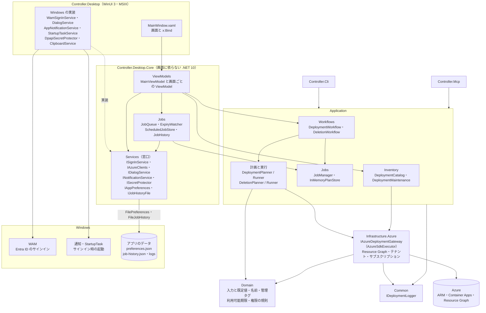
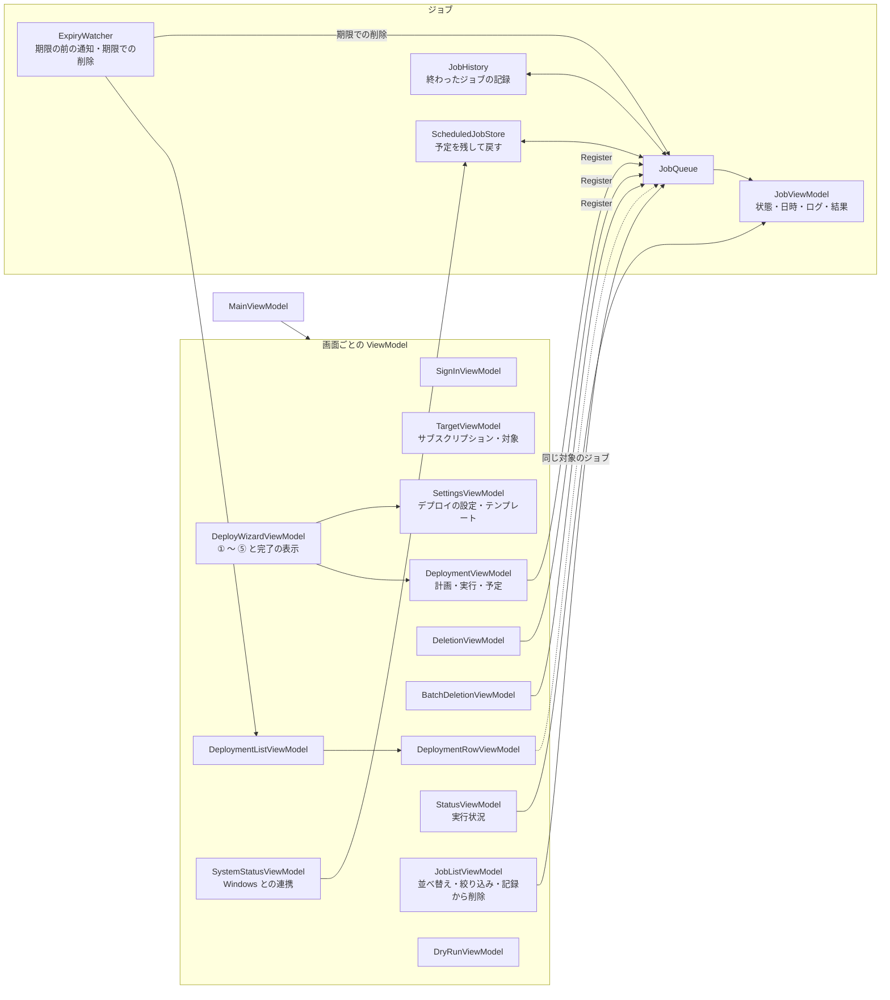
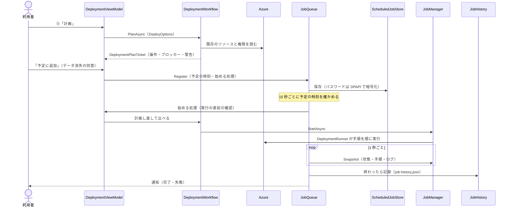
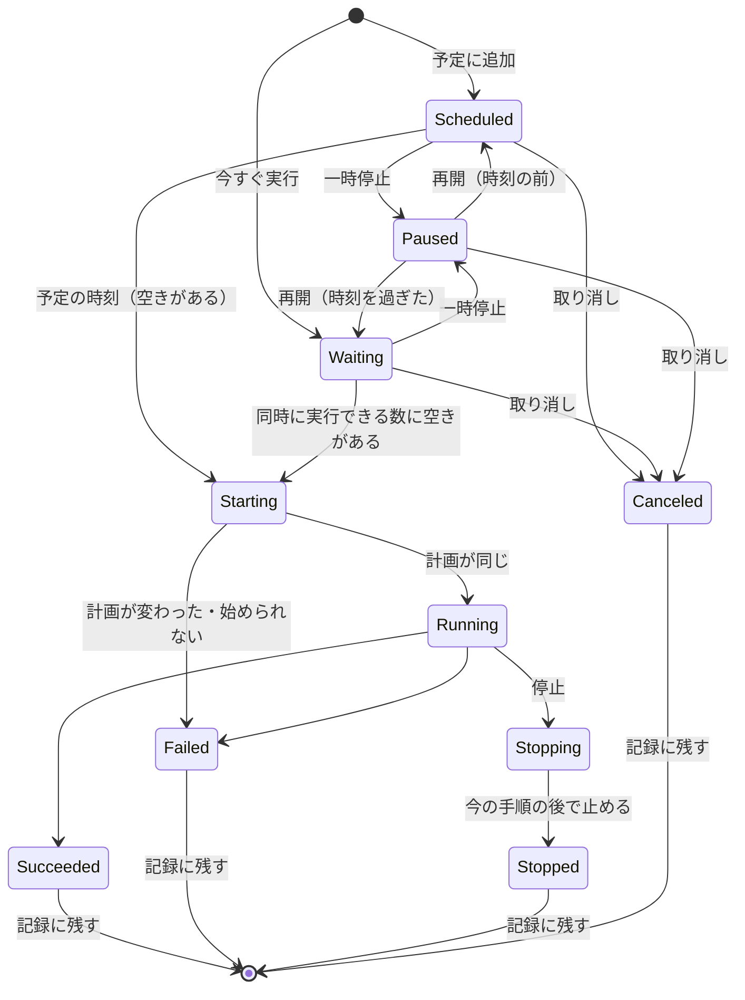
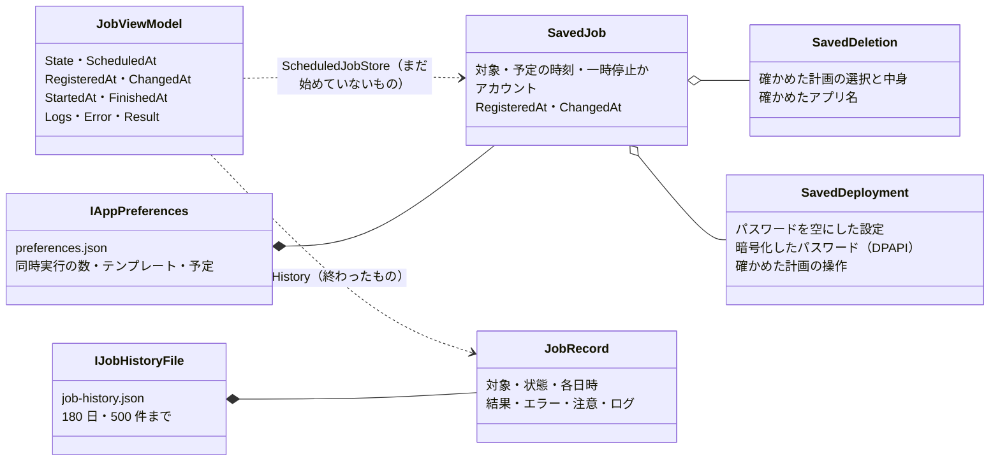

# TTDeployTool デスクトップの構造

- 対象: `feature/desktop-app` の 2026-10-27 時点のコード（REVIEW_ISSUES No.76 まで）
- 関連: [共通部分の構造](../common/README.md)（層・ドメインモデル・Azure に作るもの）・[`desktop-app.md`](desktop-app.md)（詳細設計）・[`desktop-jobs.md`](desktop-jobs.md)（ジョブ・予定・記録）・[`desktop-wizard.md`](desktop-wizard.md)（画面の流れ）
- 図は Mermaid で書いています（GitHub と、Mermaid に対応したエディターで図として表示されます）。コードの構成を変えたら、この図も直します

WinUI 3 の画面は薄く保ち、画面の動きは画面に依らない `Desktop.Core` に置いて単体テストで確かめます。デプロイと削除の計画・実行は、CLI と MCP サーバーと同じ `Application` 層を使います。

## 1. プロジェクトの構成と依存の向き

矢印は「使う」向きです。`Desktop` は Windows に固有の部分（サインイン・通知・暗号化など）だけを持ち、`Desktop.Core` が決めた窓口（インターフェース）を実装します。`Desktop.Core` の参照は `Application` だけで、Azure の型は `Application` を通して使います。

凡例: 実線: 使う（参照・呼び出し） / 点線: 窓口を実装する / 円柱: アプリの外にあるもの

## 2. Desktop.Core の中: 画面の ViewModel とジョブ

`MainViewModel` が画面全体を組み立てます。デプロイ・削除・まとめての削除・期限での削除は、どれも `JobQueue` にジョブとして登録し、同時に実行する数（既定 2）・予定の時刻・同じ対象の重複を `JobQueue` がまとめて扱います。

## 3. 予定に入れたデプロイが実行されるまで

計画 → 確認 → 実行の順に進み、予定の時刻が来たら、実行の直前に計画を作り直して、確かめた計画と同じときだけ始めます。予定はパスワードを DPAPI で暗号化して残すため、アプリを終了しても次の起動で戻ります。

## 4. ドメインモデル

デプロイ・削除の計画と結果、ジョブ、デプロイの一覧の型は、CLI・MCP サーバーと共通です。[共通部分の構造](../common/README.md)の 3 にあります。この文書では、デスクトップに固有のジョブの状態（5）と PC に残すデータ（6）を示します。

## 5. デスクトップのジョブの状態

始めるまでは `JobQueue` が状態を持ち、始めた後は Application の `Job` の状態を映します。終わった状態（完了・失敗・停止・取り消し）になったジョブは、記録として残ります。

## 6. この PC に残すデータ

Azure の状態は Azure のタグと Resource Graph が正で、PC には利用者の設定・予定・記録だけを残します。パスワードは、予定を残すと選んだデプロイの予定だけ、DPAPI で暗号化して残します。

| ファイル | 中身 | 消えるとき |
|---|---|---|
| （フォルダー） | パッケージ版は `%LOCALAPPDATA%\Packages\TTDeployTool_<発行元のハッシュ>\LocalState`、パッケージにしない場合は `%LOCALAPPDATA%\TTDeployTool`（[Windows での確認手順](desktop-app-check.md)の 2.4） | アンインストール |
| `preferences.json` | 同時に実行する数・テンプレート（パスワードなし）・出した期限の通知・まだ始めていない予定・前回のサインイン時の起動 | 予定は始めたとき・取り消したとき |
| `job-history.json` | 終わったジョブの記録（結果・ログ・日時。パスワードなし） | 180 日・500 件を超えたとき、「記録から削除」 |
| `logs/` | 診断用のログ（パスワード・トークン・アカウント名なし） | 7 日 |
| `authentication-record.json` | 前回サインインしたアカウントとテナントの識別子（AuthenticationRecord。秘密の情報なし）。トークンのキャッシュは、このフォルダーの外に DPAPI で守って置く（`desktop-app.md` の 11 の 2） | サインアウト（トークンのキャッシュは有効期限まで残る） |
