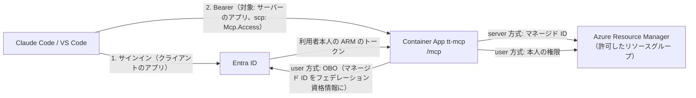

# 詳細設計: Container Apps への配置と Entra ID のアプリ登録（Phase 4c）

- 対象ブランチ: `feature/mcp-http`
- 全体設計: `docs/MCP_TOOL_DESIGN.md`（3.3 実行形態、4.11 HTTP 公開時の Azure 資格情報、6.1 動作確認のクライアント）
- 前の段階: `docs/design/mcp-phase4a.md`（HTTP と `server` 方式）、`docs/design/mcp-phase4b.md`（`user` 方式）
- 状況: **手順書とスクリプトの準備まで**。Azure と Entra ID での確認は未実施（9 の確認事項を、確認しながら直す）

## 1. 目的
4a・4b で作った HTTP のサーバーを Azure Container Apps に配置し、Entra ID のアプリ登録を用意して、Claude Code（と VS Code の確認できる範囲）から接続できるようにする。管理者が同じ手順を繰り返せるよう、スクリプトにする。

## 2. 構成
| 作るもの | 名前（既定。`-Name tt-mcp` の場合） | 役割 |
|---|---|---|
| リソースグループ | `-ResourceGroup` で指定 | MCP サーバーを置く（検証環境を作るリソースグループとは分ける） |
| ユーザー割り当てのマネージド ID | `tt-mcp-id` | `server` 方式で Azure を操作する ID。`user` 方式では、アプリ登録のフェデレーション資格情報としてトークン交換に使う |
| アプリ登録（サーバー） | `Timetracker MCP (tt-mcp)` | アクセストークンの対象（アプリケーション ID の URI は `api://<appId>` と公開 URL）。スコープ `<公開 URL>/Mcp.Access`、アプリロール 2 つ、v2 のトークン。`user` 方式なら Azure Service Management の委任アクセス許可とフェデレーション資格情報 |
| アプリ登録（クライアント） | `Timetracker MCP client (tt-mcp)` | Claude Code / VS Code がサインインに使う公開クライアント（シークレットなし）。サーバーのアプリで事前承認する |
| Container Apps の Environment | `tt-mcp-env` | ログの送信先は既定でなし（`az containerapp logs show` で見る） |
| Container App | `tt-mcp` | `ghcr.io/yamadakou/timetracker-mcp:<タグ>`、外部イングレス（HTTPS）、ポート 8080、レプリカ 1 固定、0.5 vCPU / 1Gi |
| `server` 方式の許可するリソースグループ | `-AllowedResourceGroups` | 無ければ作成し、マネージド ID に Contributor を割り当てる |



## 3. 前提
- 実行する人: サブスクリプションの所有者（ロールの割り当てができること）と、Entra ID でアプリを登録できる権限。`user` 方式の管理者の同意には、テナントの管理者（特権ロール管理者など）。管理者でない場合、スクリプトは実行した本人の分だけ同意する（ほかの利用者の分は、後で管理者が同意する）
- PowerShell 7 以上と Azure CLI（`az login` 済み、または実行時にサインイン）
- コンテナイメージ: リリース（タグの push）で GHCR に公開される。初回だけ、GHCR のパッケージ `timetracker-mcp` を public にする（4a の 7）。private のままにする場合は、Container App にレジストリの資格情報を設定する
- リソースプロバイダー: `Microsoft.App`（スクリプトで登録する）。検証環境のデプロイに必要な登録は README の「Azure リソースプロバイダーの登録」のとおり

## 4. 手順（スクリプト）
### 4.1 配置とアプリ登録
```powershell
# server 方式だけ（既定）
./scripts/deploy-mcp-http.ps1 -SubscriptionId <ID> -ResourceGroup rg-tt-mcp -AllowedResourceGroups rg-tt-team1,rg-tt-team2

# server 方式と user 方式
./scripts/deploy-mcp-http.ps1 -SubscriptionId <ID> -ResourceGroup rg-tt-mcp -IdentityModes server,user -AllowedResourceGroups rg-tt-team1

# user 方式だけ（許可するリソースグループは不要）
./scripts/deploy-mcp-http.ps1 -SubscriptionId <ID> -ResourceGroup rg-tt-mcp -IdentityModes user
```
- 同じ引数で再実行すると、作成済みのものは作り直さず、設定（アプリ登録の内容、Container App のイメージと環境変数）を合わせる。イメージの更新は `-ImageTag` を変えて再実行する
- 出力の「MCP のエンドポイント」「クライアントのアプリ」を、クライアントの設定に使う
- `-CanCreateResourceGroup` を付けると、許可したリソースグループが無いときに作成する設定になる。この場合は、マネージド ID にサブスクリプションのスコープで Contributor を手作業で割り当てる（全体設計 4.11 のとおり、既定にはしない）

スクリプトが Container App に設定する環境変数:

| 環境変数 | 値 |
|---|---|
| `TT_MCP_HTTP__TENANT_ID` | 実行したアカウントのテナント |
| `TT_MCP_HTTP__CLIENT_ID` | サーバーのアプリの appId |
| `TT_MCP_HTTP__PUBLIC_URL` | `https://<Container App 名>.<Environment の既定のドメイン>/mcp` |
| `TT_MCP_HTTP__IDENTITY_MODES` | `-IdentityModes` |
| `TT_MCP_HTTP__SERVER_IDENTITY` / `TT_MCP_HTTP__USER_CLIENT_CREDENTIAL` | `managed-identity` |
| `AZURE_CLIENT_ID` | マネージド ID のクライアント ID（ユーザー割り当て） |
| `TT_MCP_HTTP__SERVER_ALLOWED_RESOURCE_GROUPS` / `TT_MCP_HTTP__SERVER_CAN_CREATE_RESOURCE_GROUP` | `server` 方式を使う場合だけ |

### 4.2 利用者へのアプリロールの割り当て
```powershell
./scripts/assign-mcp-role.ps1 -Role Server -UserPrincipalName alice@example.com   # server 方式（と user 方式）
./scripts/assign-mcp-role.ps1 -Role User -GroupObjectId <グループの ID>             # user 方式だけ（グループは Entra ID P1 以上）
```
割り当ては、利用者が次にサインインしたトークンから有効になる。Entra 管理センターの「エンタープライズ アプリケーション」→「Timetracker MCP (tt-mcp)」→「ユーザーとグループ」からも割り当てられる。

### 4.3 クライアントの設定
- Claude Code（Entra ID は動的クライアント登録に対応していないため、クライアントのアプリの ID を指定する。コールバックのポートはスクリプトの `-ClaudeCodeCallbackPort`（既定 8765）と同じにする）
  ```powershell
  claude mcp add --transport http --client-id <クライアントのアプリの appId> --callback-port 8765 timetracker https://<FQDN>/mcp
  ```
  追加した後、Claude Code で `/mcp` を開き、`timetracker` を選んでサインインする
- VS Code（`mcp.json`。`oauth.clientId` にクライアントのアプリの appId。9 の確認事項 2 を参照）
  ```json
  {
    "servers": {
      "timetracker": {
        "type": "http",
        "url": "https://<FQDN>/mcp",
        "oauth": { "clientId": "<クライアントのアプリの appId>" }
      }
    }
  }
  ```

## 5. 手作業で行う場合の要点
スクリプトを使わない場合（ポータルで作る場合）も、次を満たすこと。
- サーバーのアプリ: アプリケーション ID の URI に `api://<appId>` と公開 URL（`https://<FQDN>/mcp`。10 の確認結果 1 のとおり、無いとサインインが AADSTS9010010 で失敗する）、スコープ `Mcp.Access`（管理者と利用者が同意できる）、アプリロール `Timetracker.Deploy.Server` / `Timetracker.Deploy.User`（メンバーの種類はユーザー）、**マニフェストの `api.requestedAccessTokenVersion` を 2** にする（1 のままだと発行者が `https://sts.windows.net/...` になり、サーバーが 401 を返す）
- `user` 方式: API のアクセス許可に Azure Service Management の `user_impersonation`（委任）を追加して管理者の同意を付与し、「証明書とシークレット」→「フェデレーション資格情報」に、マネージド ID（発行者 `https://login.microsoftonline.com/<テナント>/v2.0`、サブジェクトはマネージド ID のオブジェクト（プリンシパル）ID、対象 `api://AzureADTokenExchange`）を追加する
- クライアントのアプリ: 「パブリック クライアント フローを許可する」を有効にし、モバイル アプリとデスクトップ アプリのリダイレクト URI に `http://localhost:8765/callback`（Claude Code）を追加する。サーバーのアプリの「API の公開」で、このクライアントを `Mcp.Access` について承認済みクライアントにする
- Container App: 外部イングレス、ターゲット ポート 8080、レプリカの最小・最大を 1、ユーザー割り当てのマネージド ID、4.1 の環境変数

## 6. 確認のシナリオ
| # | 確認すること | 期待する結果 |
|---|---|---|
| 1 | `https://<FQDN>/healthz` | 200 `ok` |
| 2 | トークンなしで `POST /mcp` | 401、`WWW-Authenticate` の `resource_metadata` が `https://<FQDN>/.well-known/oauth-protected-resource` |
| 3 | `GET /.well-known/oauth-protected-resource` | `resource` が `https://<FQDN>/mcp`、`authorization_servers` がテナントの v2 の発行者、`scopes_supported` が `https://<FQDN>/mcp/Mcp.Access` |
| 4 | Claude Code で `/mcp` からサインイン | ブラウザーでサインインでき、`timetracker` が接続済みになる。サーバーのログ（`az containerapp logs show`）に利用者名と `{tid}/{oid}` が出る |
| 5 | ロールなしで `get_deployment_options` と `list_subscriptions` | 前者は使え、後者はアプリロールが必要というエラー |
| 6 | `Timetracker.Deploy.Server` で、許可したリソースグループに計画 → デプロイ → 状態の確認 → 削除 | `identity` が「MCP サーバーのマネージド ID（server 方式）」で、Timetracker の URL が返り、削除できる。アクティビティログの操作者がマネージド ID |
| 7 | `server` 方式で許可していないリソースグループに計画 | Azure を読まずにブロッカー |
| 8 | （`user` 方式）`Timetracker.Deploy.User` で、自分に Contributor があるリソースグループに計画 → デプロイ → 削除 | `identity` が「サインインした利用者本人の権限（user 方式）」。アクティビティログの操作者が本人 |
| 9 | （`user` 方式）自分に権限の無いリソースグループに計画 | 権限の事前確認で不足が示され、`plan_id` が null |
| 10 | 別の利用者で、6 の `plan_id` / `job_id` を使う | 見つからないというエラー |
| 11 | `generate_compose` | ファイルを書かず、`.env` のパスワードがプレースホルダー |
| 12 | Container App を再起動した後に `get_job_status` | ジョブが見つからない（`get_deployment_info` で状態は分かる） |

結果は `docs/REVIEW_ISSUES.md` の No.45 と、この文書の 10 に記入する。

## 7. スクリプトのテスト
- `tests/scripts/McpHttpScripts.Tests.ps1`（Pester 5 以上）。`az` を模擬に置き換え、Azure と Entra ID の状態（作成済みのもの、アプリ登録の内容、割り当て）を変えながら、呼び出しの引数と Graph に送る本文を確かめる。CI の `scripts` ジョブ（windows-latest の PowerShell 7）で毎回動かす
- `deploy-mcp-http.ps1`: 新規の配置（server と user の両方・server だけ・user だけ、配列とカンマ区切りの指定、名前・場所・タグ・ポートの指定、`-CanCreateResourceGroup`、未サインイン）、同じ引数での再実行（作成済みのものを作らない、スコープとロールの ID を変えない、管理者が加えた事前承認とリダイレクト URI を残す、場所の違う既存のリソースグループ）、誤りと失敗（無効な方式、許可するリソースグループが無い、サインインの失敗、az の失敗で止まる、管理者の同意の失敗は、実行した本人の分の同意を作って（既にあれば作らず、作れなくても）警告して続ける）
- `assign-mcp-role.ps1`: 利用者・グループへの割り当て（`-Role` の大文字小文字）、割り当て済みの判定（後のページ、別のロールだけの場合）、引数の誤り、アプリ登録が無い場合、az の失敗
- 網羅率（Pester のコマンド単位）: 325 中 324（未計上の 1 つは、Pester が数えない引数の既定値の式。既定値を使う場合もテストしている）。if のすべての分岐を、上のテストのどれかで通している

## 8. 運用の注意
- 計画とジョブはプロセスのメモリにある。レプリカを増やさないこと。デプロイ中に再起動するとジョブの情報が消える（Azure 側の処理は続く）
- ログの送信先を設定していないため、ログはコンテナの再起動で消える。だれの操作かを長く残す場合は、Environment に Log Analytics を設定する
- イメージの更新は、リリースの後に `-ImageTag` を変えてスクリプトを再実行する（`latest` のままでは、新しいリビジョンが作られないことがある）
- クライアントのアプリにシークレットは無い。サーバーのアプリにもシークレットは無い（`user` 方式のトークン交換はフェデレーション資格情報）

## 9. 確認事項（Azure と Entra ID で確かめながら直す）
確認の結果は 10 に記入した。
1. **`resource` パラメーター**: MCP のクライアントは、認可の要求に保護リソースのメタデータの `resource`（`https://<FQDN>/mcp`）を付ける（RFC 8707）。Entra ID が、スコープの対象と違う `resource` を拒否するか → **拒否した**（AADSTS9010010）。アプリケーション ID の URI に公開 URL を加え、スコープを `<公開 URL>/Mcp.Access` にして解消（10 の 1）
2. **VS Code**: Entra ID の発行者に対して、VS Code が組み込みの Microsoft 認証（VS Code のアプリの ID）を使うか、`oauth.clientId` のアプリを使うかを確かめる。組み込みを使う場合は、VS Code のアプリ（`aebc6443-996d-45c2-90f0-388ff96faa56`）をサーバーのアプリで事前承認する。`oauth.clientId` を使う場合は、VS Code のリダイレクト URI（`http://127.0.0.1:33418` と `https://vscode.dev/redirect` を想定）をクライアントのアプリに登録する → **未確認**
3. **トークンのバージョン**: クライアントが取得したトークンが v2 になっていること → **確認済み**（発行者 `https://login.microsoftonline.com/<テナント>/v2.0`、`aud` がサーバーのアプリの appId、`scp` が `Mcp.Access`、`roles` にアプリロール）
4. **OBO**: マネージド ID のフェデレーション資格情報でのトークン交換が成功すること、条件付きアクセスがあるテナントでの動き → **確認済み**。ただし、MFA と同意が必要（10 の 3・4）
5. **Claude Code のコールバック**: `http://localhost:<ポート>/callback` の完全一致 → **未確認**（Claude Code からのサインインは、利用者の PC で確認する）
6. **アプリロールの反映**: 割り当て後、クライアントのトークンの更新までの時間 → 割り当ての後に新しくサインインしたトークンには `roles` が入っていた（更新までの時間は未確認）

## 10. 確認結果
2026-10-17、Azure（japaneast、Visual Studio Enterprise のサブスクリプション）と Entra ID（テナントの管理者ではない、サブスクリプションの所有者のアカウント）で、イメージ `ghcr.io/yamadakou/timetracker-mcp:0.8.0` を `server,user` で配置して確認した。MCP のクライアントは、デバイスコードでトークンを取得する検証用のスクリプト（クライアントのアプリの ID を使い、`resource` に公開 URL を付ける）と、Streamable HTTP の最小のクライアントを使った。

### 配置とアプリ登録（スクリプト）
- `deploy-mcp-http.ps1` で、リソースグループ・マネージド ID・アプリ登録（サーバーとクライアント）・フェデレーション資格情報・Environment・Container App・許可したリソースグループへの Contributor の割り当てを作成できた。管理者の同意は権限が無いため失敗し、警告して続いた
- `assign-mcp-role.ps1` で、利用者に `Timetracker.Deploy.Server` を割り当てられた

### 確認のシナリオ（6）
| # | 結果 |
|---|---|
| 1 | 200 `ok` |
| 2 | 401。`resource_metadata` が `https://<FQDN>/.well-known/oauth-protected-resource`（Container Apps のイングレスの後ろでも https になる） |
| 3 | 期待どおり（`scopes_supported` は下の 1 の修正の後のもの） |
| 4 | 検証用のスクリプトで、`resource` 付きのサインインとトークンの取得を確認（下の 1 の修正の後）。Claude Code からのサインインは未確認 |
| 5 | ロールなしでは確認していない（利用者が 1 人のため）。ロールありで `get_deployment_options` と `list_subscriptions`（server 方式）が使えた |
| 6 | 計画（権限の事前確認は不足なし）→ デプロイ（約 2 分。Timetracker の URL が `/setup` に転送）→ `get_deployment_info` → 削除（アプリ名の不一致は拒否。約 13 分。リソースグループは残る）。アクティビティログの操作者はマネージド ID |
| 7 | Azure を読まずにブロッカー。`azure_identity` を省略して範囲外の削除を計画した場合は、`user` 方式を案内するエラー |
| 8 | 下の 3・4 の対応の後に成功。`user` 方式で、許可したリソースグループの外に、リソースグループの作成から計画 → デプロイ（約 2 分）→ 削除。`identity` は「サインインした利用者本人の権限（user 方式）」、アクティビティログの操作者は本人 |
| 9・10 | 未確認（利用者がすべてのリソースグループの所有者で、ほかの利用者がいないため） |
| 11 | ファイルを書かず、`.env` のパスワードはプレースホルダー |
| 12 | 再起動の後、`get_job_status` はジョブが見つからないというエラー |

### 見つかった問題と対応
1. **サインインが AADSTS9010010 で失敗する**（9 の 1）: クライアントが付ける `resource`（公開 URL）とスコープの対象（`api://<appId>`）が違うため。スクリプトで公開 URL をアプリケーション ID の URI に加え、サーバーのスコープ（保護リソースのメタデータの `scopes_supported`）を `<公開 URL>/Mcp.Access` にした。シングルテナントのアプリでは、`azurecontainerapps.io` の URL（検証済みのドメインではない）も追加できた。トークンの `aud` は appId のままで、サーバーの検証は変えていない
2. **サーバーが版を 1.0.0 と報告する**: リリースのビルドで版を渡していなかった（EXE も同じ）。release.yml で、タグの版を EXE とイメージのビルドに渡すようにした
3. **`user` 方式のトークン交換が AADSTS50076（MFA が必要）で失敗する**: Azure の管理 API には MFA が必須だが、MCP サーバーへのサインインで MFA が行われていなかったため。条件付きアクセスの「要求」が返らないため、クライアントにサインインし直してもらっても解消しない。サインインの要求で MFA を求める（`claims` に `amr` の `mfa`）と MFA が求められ、交換できた。ツールのエラーで、管理者に条件付きアクセスで MCP サーバーのアプリへのサインインに MFA を要求してもらうよう案内するようにした。**運用では、MCP サーバーのアプリ（エンタープライズ アプリケーション）に MFA を要求する条件付きアクセスのポリシーが必要**（Claude Code などのクライアントは `claims` を付けないため）
4. **`user` 方式のトークン交換が AADSTS65001（同意が無い）で失敗する**: 管理者の同意が無いため。テナントの管理者でないアカウントでも、本人の分の同意（`oauth2PermissionGrants`、`consentType` は `Principal`）を Graph で作ることができ、交換できた。スクリプトで、管理者の同意に失敗した場合に、実行した本人の分の同意を作るようにした。**ほかの利用者が `user` 方式を使うには、テナントの管理者の同意が必要**
