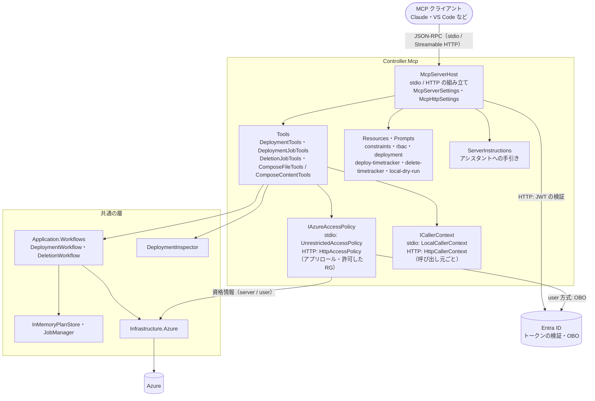
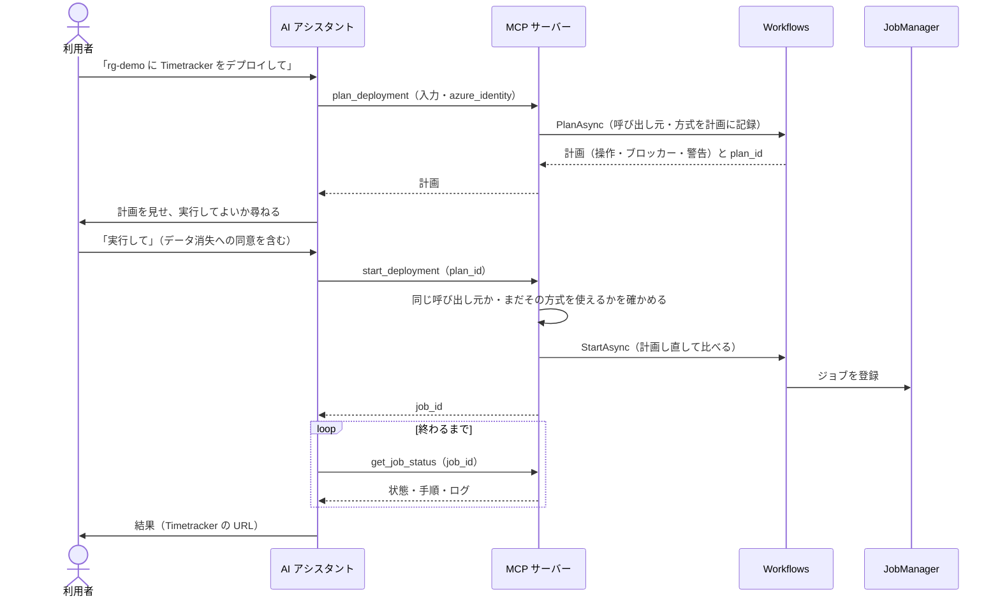
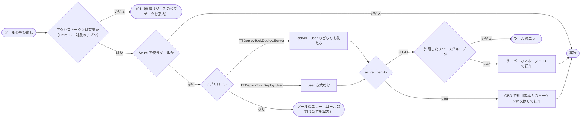

# TTDeployTool MCP サーバーの構造

- 対象: `feature/desktop-app` の 2026-10-28 時点のコード
- 関連: [共通部分の構造](../common/README.md)（層・ドメインモデル・Azure に作るもの）・[`MCP_SERVER.md`](../../MCP_SERVER.md)（使い方と設定）・[`MCP_TOOL_DESIGN.md`](../../MCP_TOOL_DESIGN.md)（全体設計）・[`mcp-phase3a.md`](mcp-phase3a.md)〜[`mcp-phase4c.md`](mcp-phase4c.md)（段階ごとの詳細設計）
- 図は Mermaid で書いています（GitHub と、Mermaid に対応したエディターで図として表示されます）。コードの構成を変えたら、この図も直します

MCP サーバー（`TTDeployTool.Controller.Mcp`）は、AI アシスタントが Timetracker のデプロイと削除を行うための入り口です。同じプログラムを 2 つの形で動かします。

- **stdio:** 利用者の PC で、MCP クライアントが子プロセスとして起動します。Azure は PC の資格情報（`TT_MCP_AUTH_MODE`）で操作します
- **HTTP:** サーバー（Container Apps）に置き、Entra ID のアクセストークンで呼び出し元を確かめます。Azure を操作する権限は、サーバーの ID（`server` 方式）か利用者本人（`user` 方式、OBO）です

## 1. プロジェクトの構成

## 2. ツール

| ツール | Azure を | 役割 |
|---|---|---|
| `get_deployment_options` | 使わない | 指定できる項目・既定値・使える方式（`azure_identity`）を返す |
| `validate_deployment` | 使わない | 入力を検証し、警告を返す |
| `generate_compose` | 使わない | Dry-run。stdio はファイルに書き、HTTP は内容を返す（サーバーには書かない） |
| `list_subscriptions` | 読む | 使えるサブスクリプションを返す |
| `plan_deployment` | 読む | デプロイの計画を作って保管し、`plan_id` を返す |
| `start_deployment` | 操作する | `plan_id` の計画を、計画し直して比べてからジョブで実行する |
| `plan_deletion` | 読む | 削除の計画を作って保管し、`plan_id` を返す |
| `start_deletion` | 操作する | 確認のアプリ名と `plan_id` で、削除をジョブで実行する |
| `get_job_status`・`list_jobs` | 使わない | ジョブの状態・手順・ログ・結果を返す |
| `get_deployment_info` | 読む | デプロイ済みの環境の状態を返す |

Resources は、本ツールの目的と注意（`constraints`）、必要な RBAC（`rbac`）、デプロイ済みの環境（`ttdeploytool://deployments/{subscription}/{resource_group}/{app_name}`）です。Prompts は、デプロイ・削除・Dry-run の進め方の定型文です。

## 3. 計画 → 確認 → 実行（ツールの呼び方）

## 4. HTTP 版の守り

- 計画とジョブは、呼び出し元（トークンの利用者）ごとに分けて保管し、ほかの人の `plan_id`・`job_id` は使えません
- 計画に方式（server / user）を記録し、実行は計画の方式で、その時点でもまだ使えるかを確かめてから行います
